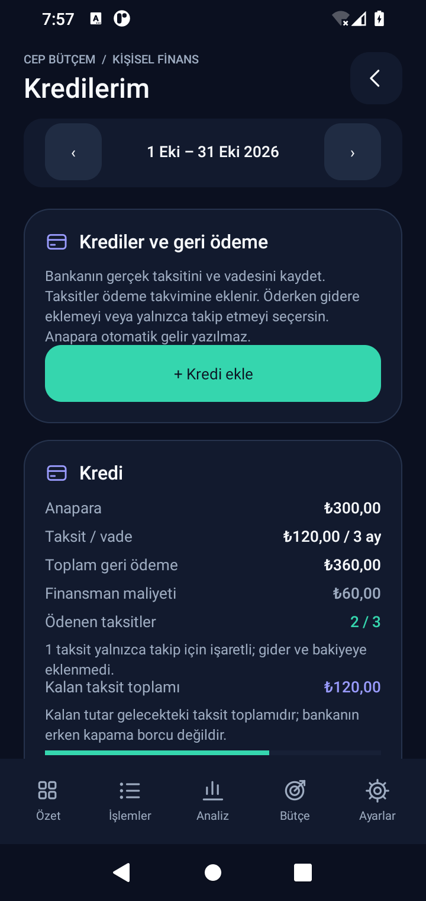
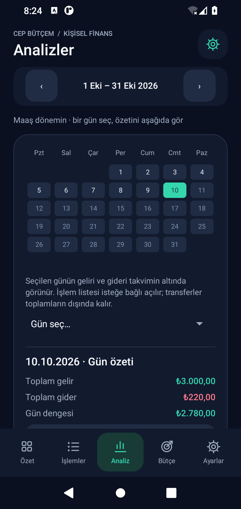
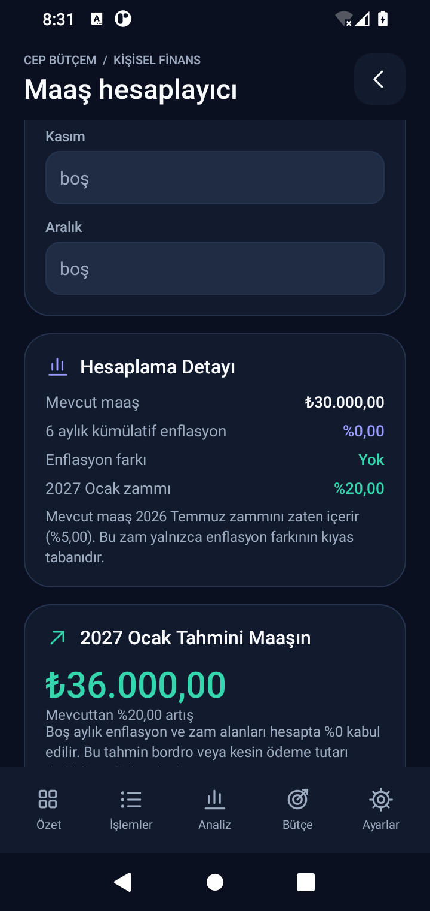
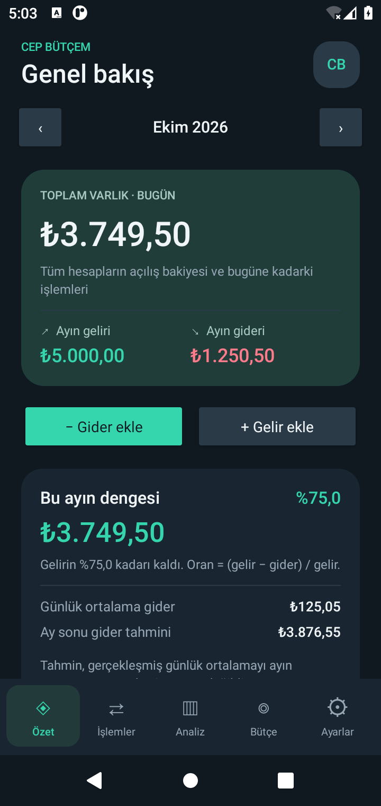
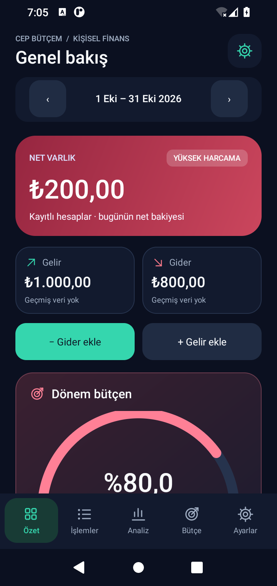
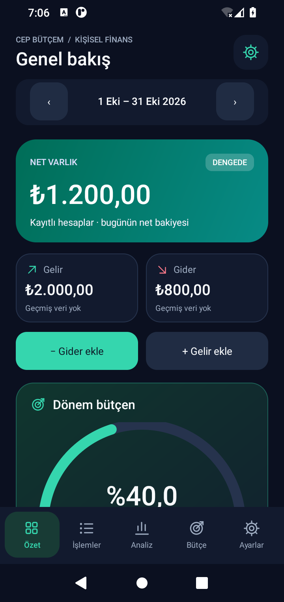
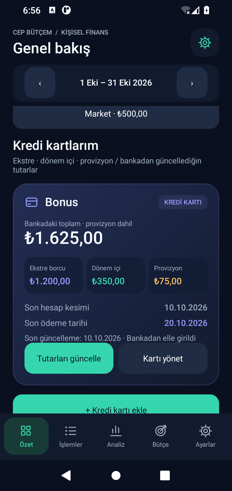
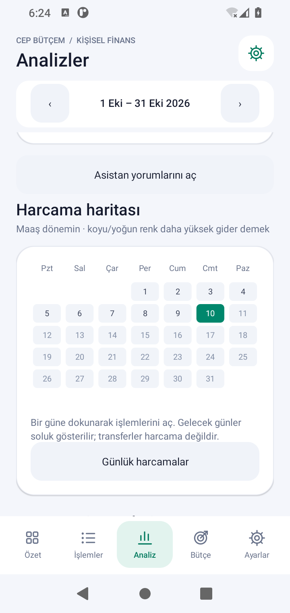

# Cep Bütçem

**Yeni Android uygulaması: [İlacım — ilaç dolabı ve randevu takibi](ilacim/README.md).** [APK indir](downloads/Ilacim.apk) · [Android Studio proje paketi](downloads/Ilacim-Android-Studio.zip). Dosya sayfasında **Download raw file** ile indir. Barkod/karekod, kutu bazında son kullanma tarihi ve stok, günlük doz planı, randevu ve yerel hatırlatmalar; API sağlayıcısı sonradan ayarlardan bağlanır.

Türkçe, çevrimdışı kişisel gelir-gider takibi ve ayrıntılı finans analizi için yerel Android uygulaması. Android Studio'da açılır ve telefona kurulabilen APK üretir. Java 17, Android'in yerel arayüz bileşenleri ve SQLite kullanır; hesap açma, internet bağlantısı veya ücretli bir servis gerekmez.

## v1.8.1 · Kartla bütünleşen ibre

İbre görünümündeki ayrı açık/koyu panel kaldırıldı; ana finans kartının zemini devam eder. Beyaz ibre, yüzde ve metinler iki temada da okunur. Yeşil/sarı/kırmızı dilimlerin ince koyu sınırı kartın risk rengiyle karışmalarını önler. Oran hesabı ve 3,5 saniyelik animasyon korunur.

## v1.8 · App.jsx göstergeleri ve kişisel planlama

- **App.jsx bütçe göstergesi:** güncel App.jsx'teki 128×128 üç renkli halka; %0–50 yeşil, %50–80 sarı, %80–100 kırmızı dilimler, aynı çizgi kalınlığı ve 3,5 saniyelik ease-out-cubic animasyon. **Ayarlar → Maaş dönemi ve görünüm → Yarım daire ibreye geç** ile ilk referanstaki 320×235 ibreyi seçebilirsin: 10 renk dilimi, 21 çizgi ve üçgen ibre. İki görünümde de gerçek gider/gelir oranı kullanılır; transferler hariçtir. %100'ün üstünde sayı gerçek oranı gösterir, çizim sınırda kalır. Gelir yoksa “—”; animasyonlar kapalıysa doğrudan son değer.
- **Hızlı işlem şablonları:** Ayarlar → Finans araçların → İşlem şablonları. Ad, tür, tutar, hesap, kategori ve açıklama saklanır. Özet'te ilk dört şablon tek dokunuşla bugüne eklenir; 10 saniye içinde Geri al kullanılabilir.
- **Gider tahmini:** yinelenen giderler ve gider olarak ödenmiş faturalar sabit giderdir. Değişken giderlerin günlük ortalaması yalnızca kalan günlere yayılır; gelecekte kayıtlı işlemler ve bekleyen faturalar ayrıca eklenir. En az 7 gün ve 3 harcama günü yoksa istatistiksel tahmin gösterilmez. Bilinen gelecek gelir ayrı sunulur; gerçekleşene kadar harcanabilir kabul edilmez.
- **Kategori uyarısı:** en az üç kayıtlı geçmiş maaş dönemindeki karşılaştırılabilir gün ortalamasının iki katını aşan gideri belirtir. Eksik dönemler sıfır varsayılmaz. Analiz → Kategori hareketleri çubuğuna dokununca tutar ve tarihler grafiğin altında görünür.
- **Birikim hedefleri:** her hedef ayrı banka/nakit hesabına bağlıdır. Para ayırmak ve geri almak gerçek transfer oluşturur; gelir/gider değildir. İlerleme hesabın bugünkü bakiyesidir. Son üç tamamlanmış dönemde pozitif net katkı varsa yaklaşık tamamlanma süresi gösterilir.
- **Kart alışveriş taksitleri:** bankadaki kredi takibinden ayrı; kart, aylık tutar, ilk tarih, toplam/ödenen taksit ve kalan yük. İşaretleme yalnızca takiptir; ekstra gider veya ekstre borcu üretmez. Kart ekranında aylık ve kalan takip yükü görünür.
- **İşlem silmede geri alma:** normal işlem silindikten sonra 10 saniye boyunca Geri al, aynı kimlik ve bakiye etkisiyle kaydı geri getirir. Bağlı fatura ödemeleri ödeme merkezinden yönetilir.
- **Ekstreye özel tarihler:** Kartı yönet → Ekstreye özel tarihler. Kesim ve son ödeme, o ekstre için takvim ve bildirimlerde kullanılır; son 24 kayıt saklanır. Önce banka tutarlarının güncel olması gerekir.

Yeni yönetim listeleri 20 kayıtla sayfalanır. Analizler ham işlem listesini yüklemek yerine tarih/kategori bazında SQL toplamlarını kullanır. JSON yedek **v7**; eski v1–v6 dosyalar desteklenir. Yeni yedeği v1.8 veya üzeriyle aç. Mevcut APK'nın üzerine güncelle; önce JSON yedek al ve uygulamayı kaldırma.

## v1.7 · Sıcak palet, bütçe halkası ve ayrı kartlar

- Açık tema: vurgu **#A74E32**, zemin **#FCF5EF**. Ana kart harcama riskine göre sıcak ton değiştirir; gelir/gider renkleri anlamlarını korur.
- Dönem bütçesi, sıfırdan güncel yüzdeye gelen yuvarlak göstergeyle sunulur. Gelir yoksa “—”; %100 aşılırsa gerçek yüzde yazılır.
- Toplam kalan ekstre ve dönem içi + provizyon, büyük finans kartının içinde iki ayrı kutudur; ödenen ekstre küçük yazıyla görünür.
- Her kutu aynı kartların önceki maaş dönemindeki son banka kaydına göre artış/azalış gösterir. Geçmiş yoksa veya bir kartın verisi eksikse oran üretilmez. Sıfır borçtan artışta yüzde yerine açıklama kullanılır.
- Kart başına son 24 maaş döneminin banka özetleri saklanır. Maaş günü değişince eski aralıklarla oran karşılaştırılmaz. İlk kullanımda önceki dönem verisi son kayıttan alınabilir; uygulama bilinmeyen geçmişi tahmin etmez.
- Ayarlar → Krediler/Maaş/Ödeme takvimi → geri, Ayarlar’a döner. Bir alt ekran başka bölümden açılmışsa geldiğin yere dönersin.
- Banka/nakit hesapları ve kartlar ayrı listelenir. İşlem formunda kaynak listesi banka/nakit içerir; giderde **Ödeme yöntemi → Kredi kartı** ayrı kart seçimini açar. Transfer iki tür arasında yapılabilir.
- Kart takibi silinince geçmiş kayıtlar korunur ve hesap banka listesine karışmaz. Ayarlar’daki Kartların bölümünden takibi yeniden açabilir veya onayla kart hesabını ve bağlı kayıtları kalıcı silebilirsin.

JSON yedek biçimi v6; v1–v5 yedekleri okunur. v6 yedeğini v1.7 ve üzeriyle aç. Kart geçmişi işlem tutarı değildir; banka özeti güncellemek tek başına gelir/gider yaratmaz.

## v1.6 · Birleşik özet, ekstre ödemeleri ve haftalık ödeme listesi

- Net varlık ve dönem bütçem tek kartta; harcama oranına göre renk ve açılış animasyonu korunur.
- Kredi kartlarının üstünde toplam **kalan ekstre borcu**, küçük **ödenen tutar**, ayrıca **dönem içi + provizyon** toplamı.
- Üç kartta 30.000 TL ekstre, 10.000 TL ödeme → **20.000 TL**, altında **10.000 TL ödendi**. Tamamı ödenirse **0 TL / 30.000 TL ödendi**.
- Karttaki tarih etiketi **Hesap Kesim Tarihi**.
- Özetin yaklaşan ödemeleri yalnızca bugün–7 gün sonraki aralığı kapsar; **5 gün kaldı** gibi bilgiler ve doğrudan ödeme işaretleme içerir. Fatura, kredi taksidi ve kayıtlı kart ekstresi birlikte listelenir.
- Kart ödeme formunda tutarı değiştirerek kısmi ödeme yapabilirsin. Transfer seçiliyse hesap aktarımı yapılır; kapatırsan yalnızca ekstre takibi güncellenir. Kredi taksidindeki bakiyeden düşme sorusu korunur.
- Banka tutarlarını güncelle formunda daha önce ödenen ekstre tutarı ayrıca girilebilir. Yeni ekstre girerken ödenen tutarı o ekstreye göre güncelle/sıfırla. Banka özetleri finansal hesap bakiyelerinden ayrı takiptir.

JSON yedeği v5; eski v1–v4 yedekleri okunur. Güncel ekranlar: [Tasarım](docs/DESIGN.md). Kontroller: [Doğrulama](docs/VALIDATION.md).

## v1.5 · Modern arayüz

Ana ekran; dekoratif yaylarla işlenen net varlık kartı, gelir/gider karşılaştırması, simgeli gider/gelir/transfer kısayolları ve kompakt dönem bütçesiyle yenilendi. Kartlar, yazı hiyerarşisi, form alanları ve alt gezinme tüm ekranlarda aynı tasarım dilini kullanır. Açık ve koyu tema ayrı paletlerle düzenlendi; bütçe oranının renk eşikleri ve sıfırdan başlayan animasyonu korunur.

[Ekran görüntüleri ve tasarım ayrıntıları](docs/DESIGN.md). Kredi, kart, maaş dönemi, App.jsx maaş hesaplayıcı ve bildirim özellikleri bu görünümle birlikte kullanılabilir.

## Hazır dosyaları GitHub’dan indirme

- [APK ve Android Studio projesi — tam paket](https://github.com/Semih-borsa/codex/blob/main/downloads/CepButcem-Tam-Paket.zip)
- [Yalnızca APK](https://github.com/Semih-borsa/codex/blob/main/downloads/CepButcem.apk)

Dosya sayfasında **Download raw file** simgesine (aşağı ok) basın. ZIP dosyası için "View raw" bağlantısı da kullanılabilir. Depo özel ise GitHub hesabınızla giriş yapmanız gerekir.

Bilgisayarda `CepButcem-Tam-Paket.zip` dosyasını **Tümünü ayıkla / Extract All** ile açın. İçindeki `CepButcem.apk` telefona kurulacak dosyadır. **CepButcem** klasörü Android Studio’da açılacak projedir; içinde `settings.gradle`, `gradlew` ve `app` bulunur.

GitHub’ın **Code → Download ZIP** seçeneği de tüm depoyu indirir; o pakette hazır APK ve tam paket `downloads` klasöründedir. Dosyaları ZIP içinden doğrudan açmayın; önce klasöre ayıklayın.

Ayrıntılı Windows indirme, telefona kurulum ve ilk ayarlar: [Adım adım kurulum](docs/KURULUM.md).

## Android Studio ile çalıştırma

1. Bu projenin **kök klasörünü** Android Studio'da açın (yalnızca `app` klasörünü değil).
2. Gradle JDK olarak **17** veya Android Studio'nun uyumlu tam JDK kurulumunu seçin. İlk senkronizasyon internet gerektirir.
3. SDK Manager'dan **Android SDK Platform 35** ve **Build-Tools 34.0.0** kurun. Android Studio gerektiğinde bunları da indirmeyi önerir.
4. Gradle senkronizasyonunu tamamlayın. Android **8.0 / API 26 veya üzeri** bir cihaz ya da emülatör seçip **Run** düğmesine basın.

Paket adı: `com.semih.cepbutcem`. Minimum Android: 8.0. Hedef/derleme SDK: 35. Gradle: 8.9. Android Gradle Plugin: 8.7.3. Para birimi: Türk lirası.

## APK oluşturup telefona kurma

Android Studio'da **Build → Build Bundle(s) / APK(s) → Build APK(s)** seçin (yeni sürümlerde **Generate App Bundles or APKs → Generate APKs** olarak görünebilir).

APK dosyası:

```
app/build/outputs/apk/debug/app-debug.apk
```

Dosyayı telefona gönderip açın; Android, dosyayı açan uygulamaya APK yükleme izni vermenizi isteyebilir. USB hata ayıklaması açık bir telefon bağlıysa `adb install -r app/build/outputs/apk/debug/app-debug.apk` komutunu da kullanabilirsiniz.

Debug APK kişisel deneme için imzalı ve kurulabilirdir. Kalıcı sürüm için **Build → Generate Signed Bundle / APK → APK** ile kendi imzanızı oluşturun. Sonraki güncellemelerde aynı imza anahtarını kullanın. İmza değişirse uygulamayı kaldırmak gerekebilir; kaldırmadan önce JSON yedeği alın. Keystore dosyası ve şifreleri Git'e eklenmemelidir.

## Özellikler

- Gelir, gider ve hesaplar arası transfer; kayıt düzenleme ve silme.
- Birden çok hesap ve pozitif/negatif açılış bakiyesi.
- Özelleştirilebilir gelir-gider kategorileri; notlar ve tarih seçimi.
- Maaş dönemine göre işlem listesi; not/kategori/hesap araması ve tür, kategori, hesap filtreleri.
- İleri tarihli kayıtların planlanan olarak işaretlenmesi.
- Her maaş döneminde tekrarlanan kategori bütçeleri; kullanım oranı, aşım, kalan tutar ve günlük kullanılabilir limit.
- Aylık düzenli gelir-giderler; kısa aylarda ay sonuna uyarlama ve aynı vadenin iki kez oluşturulmasının engellenmesi.
- JSON ile tam yedekleme/geri yükleme; Excel için Türkçe, UTF-8 BOM içeren CSV dışa aktarımı.
- Kalıcı açık/koyu tema seçimi ve gelir/gider grafikleri.

## Ayrıntılı analizler

**Analiz** ekranında seçili maaş dönemi, son üç maaş dönemi, seçili yılın 12 maaş dönemi veya özel tarih aralığı seçilebilir:

- Gelir, gider, net nakit akışı ve tasarruf oranı.
- Önceki dönem ile gelir/gider değişimi; kategori bazında değişim.
- Gelir kaynakları ve gider kategorilerinin tutarı ve yüzde payı.
- Altı maaş dönemi gelir/gider grafiği ve dönem tutar tablosu.
- Günlük ortalama, işlem başına ortalama, harcama yapılan gün sayısı ve en büyük gider.
- En çok harcanan kategori ve bu kategoride %10 azaltmanın parasal karşılığı.
- Haftanın günlerine göre, harcamasız günleri de içeren günlük ortalama gider.
- Hesap bazında gelir/gider ile transfer giriş/çıkışları.
- İçinde bulunulan maaş dönemi için günlük harcama hızına dayalı dönem sonu gider tahmini.

Grafiklerdeki tutarlar metin listelerinde de bulunur. Tahminler istatistiksel yön göstergesidir; kaydedilmemiş faturaları, fiyat değişimlerini veya gelecekteki gelirleri tahmin etmez. Asistanın ayrı senaryosu kayıtlı bekleyen faturaları dikkate alır.

## v1.4: kredi takibi, maaş araçları, bildirim ve gün özeti

- Yeni mint/altın cüzdan simgesi; Android adaptive ve tek renk tema simgesi.
- **Ayarlar → Finans araçların → Kredilerim ve taksitler**: bankanın eşit taksitli kredi planını kaydet; ödeme takviminde izle. **Ödedim → Bakiyeden düşülsün mü?** Evet gider oluşturur, Hayır yalnızca takipte ödenmiş gösterir. Her iki seçenek için ödeme geri alınabilir; aynı taksit ikinci kez ödenemez.
- Kredi ekranı anapara, toplam geri ödeme, finansman maliyeti, ödenen taksitler ve kalan taksit toplamını gösterir. Kalan taksit toplamı erken kapama borcu değildir. Faizle taksit hesaplama vergi/sigorta/masraf hariç tahmindir; bankanın tutarıyla düzelt.
- **Maaş hesaplayıcı**: `App.jsx` ile aynı Ocak/Temmuz hesabı: altı aylık bileşik enflasyon, enflasyon farkı ve sonraki dönem toplu sözleşme zammı. İki yıllık zam tablosu, yıl bazında enflasyon girişleri ve taslak/Kaydet akışı. Mevcut dönem zammı tekrar maaşa eklenmez; hesap gelir kaydı oluşturmaz.
- **Ayarlar → Ödeme bildirimleri**: aç/kapat, vade günü/1/3 gün önce, 09:00/12:00/18:00, deneme bildirimi. Android 13+ bildirim izni gerekir. Günlük yerel kontrol; Android enerji tasarrufu teslimi geciktirebilir. Zorla durdurmadan sonra uygulamayı yeniden aç. Kilit ekranında özel finansal tutarlar gizlenir. Fatura ve kredi taksitleri ile pozitif ekstre özeti olan kartlar kontrol edilir; eski kart özeti yeni bir ekstreymiş gibi ileri taşınmaz.
- **Konuya özel yardım**: günlük harcama payı, kredi yükü, kart özeti, kategori tasarrufu ve alışveriş senaryosu. Yerel, açıklanabilir hesaplar; otomatik finansal kayıt üretmez.
- **Analiz → Harcama haritası**: güne dokununca gelir/gider/net özet takvimin altında açılır. İşlem detayları varsayılan olarak kapalıdır; açıldığında 50 kayıtlık sayfalarla gösterilir. Gün seçimi için erişilebilir açılır liste de vardır.
- Geçmişin tamamını her ekran açılışında Java nesnelerine okumak kaldırıldı. Dönem raporları SQL'de gruplandırılır; gerçek işlemler SQL'de filtrelenerek 50'lik sayfalarda alınır. Ödeme kartları 20'lik sayfalardır. Okuma ve rapor işleri arka planda, arama 180 ms gecikmeyle; eski yanıtlar yeni ekranı değiştirmez. Tarih/hesap/hedef/kategori ve covering rapor indeksleri, günlük bakiye toplamları ve WAL etkin. Düzenleme/silme/transfer toplamları aynı veritabanı işleminde güncellenir.

JSON **v4**, SQLite **v3**. JSON v1–v3 ve eski SQLite v1/v2 korunarak yükseltilir. Kredi planı, yalnızca takip ödeme tarihleri ve gerçek ödeme kayıtları yedekte korunur. Bildirim izni/cihaz bildirim tercihi cihaz bazlıdır, JSON'a taşınmaz; yeni telefonda yeniden açılır.

   

## v1.3: dinamik renkler, banka özeti ve hesap yönetimi

Net varlık kartı, dönem bütçesi ve gösterge aynı maaş dönemi harcama oranını kullanır: **%50 altı yeşil, %50–80 sarı, %80+ kırmızı**. Gelir yoksa nötrdür. Yüzde açılışta 0'dan gerçek değere bir saniyede ilerler; Android animasyonları kapalıysa doğrudan son değeri gösterir.

**Özet → Kredi kartlarım → Kredi kartı ekle** ile ayrı hesap otomatik oluştur veya mevcut hesabı seç. **Tutarları güncelle** ekranında bankadaki **kalan ekstre**, **dönem içi borç**, **provizyon** tutarlarını elle gir. Her kart üç ayrı kutu, toplam ve son güncelleme tarihiyle görünür. Bu banka özeti gelir/gider ve net varlık kayıtlarını değiştirmez; ödeme transferi sonrası tutarları bankadan yeniden güncelle. Üç alan birbirini içermeyen tutarlardır.

**Kartı yönet → Kart takibini sil**, yalnızca özet kartı/banka bilgilerini kaldırır; finansal hesap ve kayıtlar korunur. **Hesabı sil** veya **Kart hesabını ve kayıtlarını sil**, bağlı işlemleri (iki yönlü transferler dahil), düzenli kuralları, faturaları ve kart takibini kalıcı kaldırır. Onay ekranı kapsamı gösterir. En az bir hesap kalır; bu işlem diğer hesap bakiyelerini ve geçmiş raporları etkileyebilir. Silmeden önce JSON yedeği al.

**[Altı bölümlük mobil/web mimari ve kod rehberi](docs/ARCHITECTURE.md)**: UI/UX, PostgreSQL şeması, REST/JWT controller örnekleri, React/Tailwind bileşenleri, MVP+ fikirleri ve dört haftalık plan. **[Çalışan web referansı](web-reference/README.md)** mobil ve masaüstü form/özet ekranını içerir; oturumluk demo verisi kullanır, Android veritabanına veya bir backend'e bağlı değildir.

JSON yedek sürümü **3**: kartın üç tutarı ve güncelleme tarihi de korunur. v1/v2 yedekleri desteklenir; tutarsız banka özeti dosyası eski veriler silinmeden reddedilir. SQLite şeması v2 kalır; v1.2 APK üzerine güncelleme kayıtları korur.

## v1.2: modern Android arayüzü

Paylaşılan App.jsx tasarımından ilham alan gradyan bakiye kartı, kompakt gelir/gider kartları, yarım daire harcama göstergesi, yatay hesap kartları, çizgi ikonları ve düzenli açık/koyu temalar eklendi. Ana ekranda kısa asistan özeti bulunur; **Asistan yorumlarını incele** ayrıntıları açar. Analizde yorumlar açılıp daraltılır.

**Ödeme takvimini aç** düğmesi ana ekranda ve Ayarlar'da bulunur; kart tarihleri, faturalar ve ödeme/geri alma işlemleri bu ekrandadır. **Analiz → Harcama haritası** bölümünde bir güne dokunarak kayıtlarını gör; **Günlük harcamalar** aynı veriyi liste olarak sunar.

**Hızlı tekrar** önceki giderlerinden oluşturulur. İşlem satırına basılı tutarak da yeni bir işlem formu açabilirsin. Kaydet'e basılmadan yeni kayıt oluşmaz; önceki işlem değişmez. Faturaya bağlı ödemeleri ödeme takviminden yönet.

Uyarlanan fikirler ve korunan muhasebe kuralları: [Tasarım notları](docs/DESIGN.md). v1.2, v1.1 kayıtlarını ve JSON v2 yedeklerini korur; minimum Android 8.0 devam eder.

## v1.1: maaş dönemim, ödeme takvimi ve bütçe asistanı

**Ayarlar → Maaş günü ve hedefi değiştir** ile maaş gününü (1–31) ve tasarruf hedefini (%0–100) seç. Örneğin 15 seçildiğinde dönem 15 Ekim–14 Kasım olur. Ay seçici, dönemin başladığı ayı seçer. 31 seçilirse kısa ayın son günü kullanılır; sonraki dönem tekrar 31'de başlar. Varsayılan gün 1 eski takvim ayı davranışını korur. Özel tarih analizi seçilen tarihleri kullanır.

**Ayarlar → Açık temaya geç / Koyu temaya geç** ile görünümü değiştir; tercih kapanış ve yeniden açılışta korunur.

**Kredi kartı:** önce kart için ayrı bir hesap aç; mevcut borcu negatif açılış bakiyesi yap. **Özet → Kredi kartı ekle** ile hesap kesim ve son ödeme günlerini seç. Alışverişleri kart hesabına gider, borç ödemesini **Kart borcu öde · transfer** ile banka/nakit hesabından karta transfer kaydet. Bu ödeme gideri ikinci kez artırmaz. Takvim, son kesim/son ödeme/sonraki kesimi gösterir. Önceki kesimdeki borçtan kesim sonrası transferler düşülerek kalan ekstre borcu tahmini çıkarılır; bankanın gerçek ekstresi, iade/faiz ve tatil değişiklikleri esas alınmalıdır. Kart numarası veya banka şifresi istenmez.

**Fatura:** ad, tutar, hesap, kategori ve son ödeme tarihi ekle. Bekleyen, bugün ödenecek, gecikmiş ve ödenmiş durumları görünür. **Ödemeyi kaydet** tek bir gider oluşturur; aynı fatura tekrar ödenemez. Aylık tekrar seçilmişse ödeme sonrası sonraki aya aynı tahmini tutarlı fatura açılır; gerçek tutarı geldiğinde düzenle. 31'inci gün şubatta kısalırken martta tekrar 31'e döner. Faturaya bağlı giderin düzenlenmesi için önce **Ödemeyi geri al** kullan. Geri alma sonraki faturayı korur; eski faturanın otomatik tekrarını kapatır. Aynı ödemeyi ayrıca düzenli gider olarak tanımlama.

**Bütçe asistanı:** gelirin harcanan yüzdesi (`gider / gelir × 100`, %100 aşılabilir), tasarruf hedefi, önceki dönemin aynı günlerine göre gelir/gider değişimi, artışa en fazla katkı yapan kategori ve en büyük kategoride %10 azaltma senaryosu verir. Gelir yoksa oran hesaplanmaz; önceki kayıt yoksa artış/azalış sonucuna varılmaz. Maaşın yatış zamanının karşılaştırmayı etkileyebileceği belirtilir.

Dönem sonu senaryosu `(gerçekleşmiş gider − ödenmiş takipli faturalar) / geçen gün × dönem gün sayısı + ödenmiş takipli faturalar + dönem sonuna kadar bekleyen/gecikmiş faturalar` kullanır. Bilinen fatura ödemeleri günlük ortalamadan çıkarılır; bir kez eklenir ve dönem sonuna doğru tekrar büyütülmez. Diğer giderler günlük hızla tahmin edilir. Gelecek gelir varsayılmaz. Kalan günlük hedef payı, kayıtlı gelirden giderleri, bekleyen faturaları ve tasarruf hedefini çıkarıp yarından dönem sonuna kalan günlere böler; bu tutar bankadaki kullanılabilir bakiye değildir. Kredi kartı ödeme transferleri harcama senaryosuna eklenmez; ayrıca ödeme takviminden takip edilir. İlk 7 günde tahminin oynaklığı açıklanır.

Asistan çevrimdışı hesaplama ve açıklanabilir kurallar kullanır; bir dil modeli veya banka bağlantısı içermez. Yorumlar kayıtlara dayanır; eksik kayıtlar sonuçları değiştirir. v1.1’de takvim uygulama içindeydi; v1.4’te isteğe bağlı yerel ödeme bildirimleri de vardır.

v1.1 güncellemesi SQLite v1 kayıtlarını silmeden v2'ye geçirdi; güncel v1.8, v1/v2'yi v3'e yükseltir. Hazır APK önceki yayımlanan APK ile aynı debug anahtarıyla imzalanır. Kurmadan önce **JSON yedeğini kaydet** ile yedek al; APK'yı güncelleme olarak kur, uygulamayı kaldırma. Android Studio'da farklı imzayla derlenen bir sürümün üzerine kurmak imza uyuşmazlığı oluşturabilir.

## İlk kullanım

**Ayarlar** bölümünde Nakit ve Banka hesaplarının açılış bakiyesini düzenleyin veya yeni hesap ekleyin. Ardından **Özet** ekranından gelir ve giderlerinizi girin. **Bütçe** bölümünde kategori limitlerini belirleyin. Başlangıçta örnek finansal veri eklenmez; tüm göstergeler sizin kayıtlarınızdan oluşur.

Tutarları `1250,50` veya `1.250,50` biçiminde yazabilirsiniz. En fazla iki ondalık basamak kullanılır. Açılış bakiyeleri negatif olabilir; işlem tutarları pozitif olmalıdır. İşlem başına üst sınır 1 milyar TL'dir. Tarihler 2000–2100 aralığında seçilir.

Düzenli işlemler **Ayarlar → Aylık düzenli işlem** ile tanımlanır. Uygulama açıldığında geçmişten bugüne vadesi gelen kayıtlar eklenir. İlk tarihi geçmişte seçmek, o tarihten itibaren aylık kayıtlar oluşturur. Düzenli kuralı durdurmak geçmiş kayıtları silmez; tek bir geçmiş kaydı silmek aynı vadenin yeniden oluşturulmasına yol açmaz.

## Hesaplama kuralları ve veriler

- Tutarlar kayan nokta yerine **tam sayı kuruş** olarak saklanır.
- Hesap bakiyesi = açılış + gelir − gider + transfer giriş − transfer çıkış.
- Açılış bakiyesi gelir değildir. Transferler gelir, gider, kategori dağılımı ve tasarruf oranına dahil edilmez.
- Özet'teki **Net varlık** her zaman bugünün bakiyesidir. Dönem göstergeleri seçili maaş dönemine aittir.
- İleri tarihli kayıtlar işlem listesinde görünür; bakiyeye ve gerçekleşmiş analizlere henüz katılmaz.
- Tasarruf oranı = `(gelir − gider) / gelir × 100`. Gelir yoksa oran hesaplanmaz.
- Maaş dönemi karşılaştırması, önceki dönemin aynı geçen gün sayısına yapılır; önceki dönem sonu sınırdır. Diğer aralıklar önceki eşit uzunluktaki gerçekleşmiş dönem ile karşılaştırılır.
- Günlük ortalama, aralıktaki **tüm takvim günlerine** bölünür. Dönem sonu tahmini = gerçekleşmiş gider / geçen gün × maaş döneminin gün sayısı.
- Bütçeler kategori bazında her maaş döneminde aynı limiti uygular. Bütçesi olmayan kategoriler bütçe toplamlarına katılmaz.

Uygulama internet izni istemez, banka bağlantısı veya reklam içermez. SQLite dosyası Android'in uygulamaya özel alanındadır. Otomatik Android bulut yedeklemesi kapalıdır. Uygulamayı kaldırmak yerel verileri siler.

JSON v4 yedeği maaş hesaplama ayarları, yıl bazında enflasyon/zam tabloları, kredi planları ve takip ödeme durumları ile hesapları, kategorileri, işlemleri, düzenli kuralları, bütçeleri, kart tarihlerini, faturaları, maaş günü, tema ve hedef ayarlarını içerir. Eski v1/v2/v3 yedekleri desteklenir; v1 yeni ayarlar için varsayılanları kullanır; banka özeti olmayan v2 kartlarında alanlar henüz girilmemiş gösterilir. Geri yükleme mevcut verileri tamamen değiştirir; dosya önce doğrulanır, veritabanı işlemi başarısızsa eski veriler geri alınır. En fazla 16 MB JSON dosyası kabul edilir. Yedek ve CSV dosyaları **şifrelenmez**; bunları güvenli bir yerde saklayın. CSV geri yükleme desteklenmez; geri yüklemek için JSON kullanın.

## Komut satırı ve testler

Tam JDK 17 ve Android SDK kuruluyken, `local.properties` içinde yerel SDK yolunu tanımlayın; bu dosya Git'e eklenmez. Örnek: `sdk.dir=/Users/you/Library/Android/sdk`.

macOS / Linux:

```sh
./gradlew testDebugUnitTest lintDebug assembleDebug
```

Windows:

```bat
gradlew.bat testDebugUnitTest lintDebug assembleDebug
```

Para hesaplama testleri JUnit ile JVM üzerinde çalışır. Gerçek Android SQLite davranışı için cihaz/emülatör bağlıyken:

```sh
./gradlew connectedDebugAndroidTest
```

Animasyon testleri için test emülatöründe Android animator ölçeği 1 olmalı; test öncesi mevcut değeri kaydet, test sonrası geri yükle. Animasyonlar kapalıyken beklenen davranış ayrı test edilir. Fiziksel telefonun tercihlerini otomatik değiştirme.

Android testleri ayrı `ledger-validation.db` veritabanında çalışır; kişisel kayıt veritabanını kullanmaz. Kapsam: varsayılanlar, kayıt düzenleme/silme, hesaplar, transferler, kategori uyumu, bütçeler, düzenli işlem idempotansı/ay sonu, yedek dönüşümü, bozuk yedek/işlem geri alma ve CSV güvenliği.

## Proje düzeni

- `Finance.java`: Android bağımsız para ve analiz hesapları.
- `Planning.java`: kart/fatura/kredi ve kalıcı ayarlar; yedek doğrulaması.
- `Calculators.java`: bileşik enflasyonla maaş ve eşit taksit tahminleri.
- `Reminders.java` / `ReminderReceiver.java`: yerel bildirim ve günlük kontrol.
- `Ledger.java`: SQLite, düzenli kayıt üretimi, CSV ve JSON.
- `MainActivity.java`: beş ana bölüm, ödeme/asistan ekranları, formlar ve sistem dosya seçicisi.
- `Design.java`: yerel ikonlar, harcama göstergesi ve günlük harita.
- `Charts.java`: yerel Canvas grafikleri.
- `app/src/test`: para hesaplama testleri.
- `app/src/androidTest`: gerçek Android veritabanı testleri.

APK imzalama, telefon bağlantısı ve emülatör Android Studio tarafından yönetilir. Bu sürüm TL kullanır; döviz dönüşümü, banka senkronizasyonu ve uygulama içi PIN/kilit içermez.

## Ekran görüntüleri ve doğrulama

Aşağıdaki tutarlar emülatörde girilen test kayıtlarıdır; uygulama boş verilerle başlar.

  

 

Web referansı: [mobil](docs/screenshots/web-mobile.png) · [masaüstü](docs/screenshots/web-desktop.png).

Derleme, Android/web testleri, 100.000 kayıt ve UI kontrolü sonuçları: [Doğrulama kaydı](docs/VALIDATION.md).
