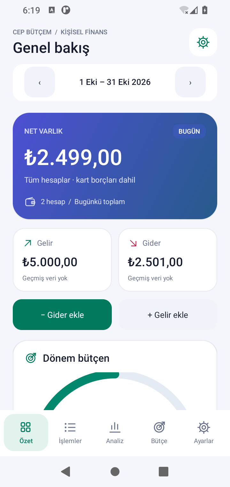
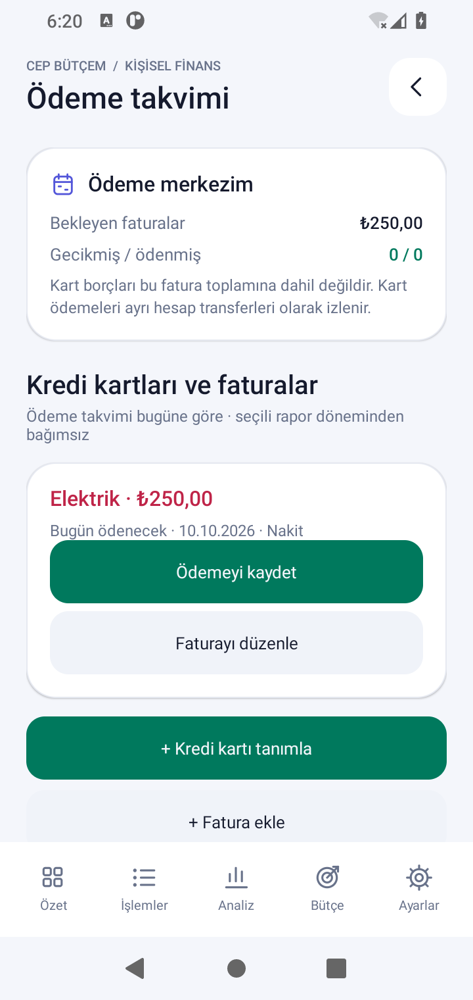
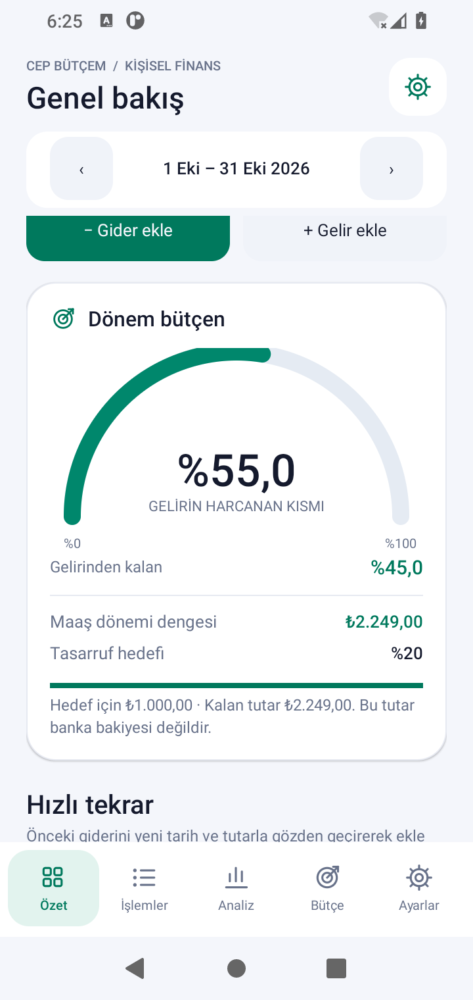
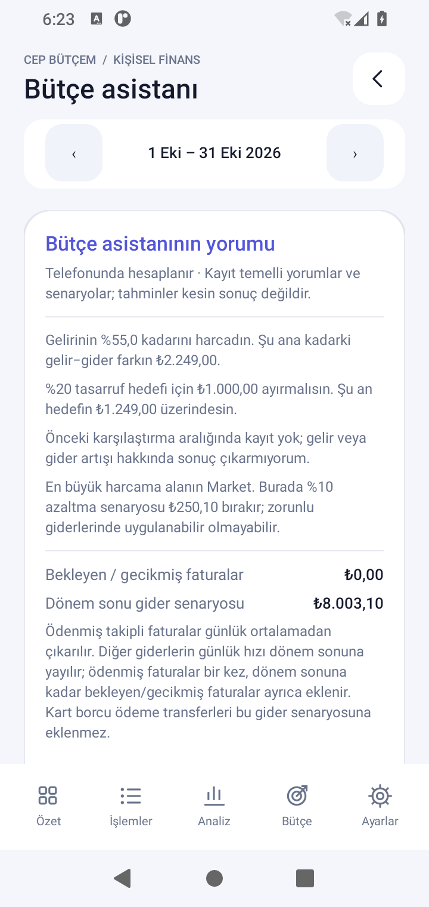

# Cep Bütçem

Türkçe, çevrimdışı kişisel gelir-gider takibi ve ayrıntılı finans analizi için yerel Android uygulaması. Android Studio'da açılır ve telefona kurulabilen APK üretir. Java 17, Android'in yerel arayüz bileşenleri ve SQLite kullanır; hesap açma, internet bağlantısı veya ücretli bir servis gerekmez.

## Hazır dosyaları GitHub’dan indirme

- [APK ve Android Studio projesi — tam paket](https://github.com/Semih-borsa/codex/blob/main/downloads/CepButcem-Tam-Paket.zip)
- [Yalnızca APK](https://github.com/Semih-borsa/codex/blob/main/downloads/CepButcem.apk)

Dosya sayfasında **Download raw file** simgesine (aşağı ok) basın. ZIP dosyası için "View raw" bağlantısı da kullanılabilir. Depo özel ise GitHub hesabınızla giriş yapmanız gerekir.

Bilgisayarda `CepButcem-Tam-Paket.zip` dosyasını **Tümünü ayıkla / Extract All** ile açın. İçindeki `CepButcem.apk` telefona kurulacak dosyadır. **CepButcem** klasörü Android Studio’da açılacak projedir; içinde `settings.gradle`, `gradlew` ve `app` bulunur.

GitHub’ın **Code → Download ZIP** seçeneği de tüm depoyu indirir; o pakette hazır APK ve tam paket `downloads` klasöründedir. Dosyaları ZIP içinden doğrudan açmayın; önce klasöre ayıklayın.

Ayrıntılı Windows indirme, telefona kurulum ve ilk ayarlar: [Adım adım kurulum](docs/KURULUM.md).

## Android Studio ile çalıştırma

1. Bu projenin **kök klasörünü** Android Studio'da açın (yalnızca `app` klasörünü değil).
2. Gradle JDK olarak **17** veya Android Studio'nun uyumlu tam JDK kurulumunu seçin. İlk senkronizasyon internet gerektirir.
3. SDK Manager'dan **Android SDK Platform 35** ve **Build-Tools 34.0.0** kurun. Android Studio gerektiğinde bunları da indirmeyi önerir.
4. Gradle senkronizasyonunu tamamlayın. Android **8.0 / API 26 veya üzeri** bir cihaz ya da emülatör seçip **Run** düğmesine basın.

Paket adı: `com.semih.cepbutcem`. Minimum Android: 8.0. Hedef/derleme SDK: 35. Gradle: 8.9. Android Gradle Plugin: 8.7.3. Para birimi: Türk lirası.

## APK oluşturup telefona kurma

Android Studio'da **Build → Build Bundle(s) / APK(s) → Build APK(s)** seçin (yeni sürümlerde **Generate App Bundles or APKs → Generate APKs** olarak görünebilir).

APK dosyası:

```
app/build/outputs/apk/debug/app-debug.apk
```

Dosyayı telefona gönderip açın; Android, dosyayı açan uygulamaya APK yükleme izni vermenizi isteyebilir. USB hata ayıklaması açık bir telefon bağlıysa `adb install -r app/build/outputs/apk/debug/app-debug.apk` komutunu da kullanabilirsiniz.

Debug APK kişisel deneme için imzalı ve kurulabilirdir. Kalıcı sürüm için **Build → Generate Signed Bundle / APK → APK** ile kendi imzanızı oluşturun. Sonraki güncellemelerde aynı imza anahtarını kullanın. İmza değişirse uygulamayı kaldırmak gerekebilir; kaldırmadan önce JSON yedeği alın. Keystore dosyası ve şifreleri Git'e eklenmemelidir.

## Özellikler

- Gelir, gider ve hesaplar arası transfer; kayıt düzenleme ve silme.
- Birden çok hesap ve pozitif/negatif açılış bakiyesi.
- Özelleştirilebilir gelir-gider kategorileri; notlar ve tarih seçimi.
- Maaş dönemine göre işlem listesi; not/kategori/hesap araması ve tür, kategori, hesap filtreleri.
- İleri tarihli kayıtların planlanan olarak işaretlenmesi.
- Her maaş döneminde tekrarlanan kategori bütçeleri; kullanım oranı, aşım, kalan tutar ve günlük kullanılabilir limit.
- Aylık düzenli gelir-giderler; kısa aylarda ay sonuna uyarlama ve aynı vadenin iki kez oluşturulmasının engellenmesi.
- JSON ile tam yedekleme/geri yükleme; Excel için Türkçe, UTF-8 BOM içeren CSV dışa aktarımı.
- Kalıcı açık/koyu tema seçimi ve gelir/gider grafikleri.

## Ayrıntılı analizler

**Analiz** ekranında seçili maaş dönemi, son üç maaş dönemi, seçili yılın 12 maaş dönemi veya özel tarih aralığı seçilebilir:

- Gelir, gider, net nakit akışı ve tasarruf oranı.
- Önceki dönem ile gelir/gider değişimi; kategori bazında değişim.
- Gelir kaynakları ve gider kategorilerinin tutarı ve yüzde payı.
- Altı maaş dönemi gelir/gider grafiği ve dönem tutar tablosu.
- Günlük ortalama, işlem başına ortalama, harcama yapılan gün sayısı ve en büyük gider.
- En çok harcanan kategori ve bu kategoride %10 azaltmanın parasal karşılığı.
- Haftanın günlerine göre, harcamasız günleri de içeren günlük ortalama gider.
- Hesap bazında gelir/gider ile transfer giriş/çıkışları.
- İçinde bulunulan maaş dönemi için günlük harcama hızına dayalı dönem sonu gider tahmini.

Grafiklerdeki tutarlar metin listelerinde de bulunur. Tahminler istatistiksel yön göstergesidir; kaydedilmemiş faturaları, fiyat değişimlerini veya gelecekteki gelirleri tahmin etmez. Asistanın ayrı senaryosu kayıtlı bekleyen faturaları dikkate alır.

## v1.2: modern Android arayüzü

Paylaşılan App.jsx tasarımından ilham alan gradyan bakiye kartı, kompakt gelir/gider kartları, yarım daire harcama göstergesi, yatay hesap kartları, çizgi ikonları ve düzenli açık/koyu temalar eklendi. Ana ekranda kısa asistan özeti bulunur; **Asistan yorumlarını incele** ayrıntıları açar. Analizde yorumlar açılıp daraltılır.

**Ödeme takvimini aç** düğmesi ana ekranda ve Ayarlar'da bulunur; kart tarihleri, faturalar ve ödeme/geri alma işlemleri bu ekrandadır. **Analiz → Harcama haritası** bölümünde bir güne dokunarak kayıtlarını gör; **Günlük harcamalar** aynı veriyi liste olarak sunar.

**Hızlı tekrar** önceki giderlerinden oluşturulur. İşlem satırına basılı tutarak da yeni bir işlem formu açabilirsin. Kaydet'e basılmadan yeni kayıt oluşmaz; önceki işlem değişmez. Faturaya bağlı ödemeleri ödeme takviminden yönet.

Uyarlanan fikirler ve korunan muhasebe kuralları: [Tasarım notları](docs/DESIGN.md). v1.2, v1.1 kayıtlarını ve JSON v2 yedeklerini korur; minimum Android 8.0 devam eder.

## v1.1: maaş dönemim, ödeme takvimi ve bütçe asistanı

**Ayarlar → Maaş günü ve hedefi değiştir** ile maaş gününü (1–31) ve tasarruf hedefini (%0–100) seç. Örneğin 15 seçildiğinde dönem 15 Ekim–14 Kasım olur. Ay seçici, dönemin başladığı ayı seçer. 31 seçilirse kısa ayın son günü kullanılır; sonraki dönem tekrar 31'de başlar. Varsayılan gün 1 eski takvim ayı davranışını korur. Özel tarih analizi seçilen tarihleri kullanır.

**Ayarlar → Açık temaya geç / Koyu temaya geç** ile görünümü değiştir; tercih kapanış ve yeniden açılışta korunur.

**Kredi kartı:** önce kart için ayrı bir hesap aç; mevcut borcu negatif açılış bakiyesi yap. **Ödeme takvimi → Kredi kartı tanımla** ile hesap kesim ve son ödeme günlerini seç. Alışverişleri kart hesabına gider, borç ödemesini **Kart borcu öde · transfer** ile banka/nakit hesabından karta transfer kaydet. Bu ödeme gideri ikinci kez artırmaz. Takvim, son kesim/son ödeme/sonraki kesimi gösterir. Önceki kesimdeki borçtan kesim sonrası transferler düşülerek kalan ekstre borcu tahmini çıkarılır; bankanın gerçek ekstresi, iade/faiz ve tatil değişiklikleri esas alınmalıdır. Kart numarası veya banka şifresi istenmez.

**Fatura:** ad, tutar, hesap, kategori ve son ödeme tarihi ekle. Bekleyen, bugün ödenecek, gecikmiş ve ödenmiş durumları görünür. **Ödemeyi kaydet** tek bir gider oluşturur; aynı fatura tekrar ödenemez. Aylık tekrar seçilmişse ödeme sonrası sonraki aya aynı tahmini tutarlı fatura açılır; gerçek tutarı geldiğinde düzenle. 31'inci gün şubatta kısalırken martta tekrar 31'e döner. Faturaya bağlı giderin düzenlenmesi için önce **Ödemeyi geri al** kullan. Geri alma sonraki faturayı korur; eski faturanın otomatik tekrarını kapatır. Aynı ödemeyi ayrıca düzenli gider olarak tanımlama.

**Bütçe asistanı:** gelirin harcanan yüzdesi (`gider / gelir × 100`, %100 aşılabilir), tasarruf hedefi, önceki dönemin aynı günlerine göre gelir/gider değişimi, artışa en fazla katkı yapan kategori ve en büyük kategoride %10 azaltma senaryosu verir. Gelir yoksa oran hesaplanmaz; önceki kayıt yoksa artış/azalış sonucuna varılmaz. Maaşın yatış zamanının karşılaştırmayı etkileyebileceği belirtilir.

Dönem sonu senaryosu `(gerçekleşmiş gider − ödenmiş takipli faturalar) / geçen gün × dönem gün sayısı + ödenmiş takipli faturalar + dönem sonuna kadar bekleyen/gecikmiş faturalar` kullanır. Bilinen fatura ödemeleri günlük ortalamadan çıkarılır; bir kez eklenir ve dönem sonuna doğru tekrar büyütülmez. Diğer giderler günlük hızla tahmin edilir. Gelecek gelir varsayılmaz. Kalan günlük hedef payı, kayıtlı gelirden giderleri, bekleyen faturaları ve tasarruf hedefini çıkarıp yarından dönem sonuna kalan günlere böler; bu tutar bankadaki kullanılabilir bakiye değildir. Kredi kartı ödeme transferleri harcama senaryosuna eklenmez; ayrıca ödeme takviminden takip edilir. İlk 7 günde tahminin oynaklığı açıklanır.

Asistan çevrimdışı hesaplama ve açıklanabilir kurallar kullanır; bir dil modeli veya banka bağlantısı içermez. Yorumlar kayıtlara dayanır; eksik kayıtlar sonuçları değiştirir. Arka planda ödeme bildirimi gönderilmez; takvim uygulama içinde gösterilir.

Güncelleme SQLite v1 kayıtlarını silmeden v2'ye geçirir. Hazır APK önceki yayımlanan APK ile aynı debug anahtarıyla imzalanır. Kurmadan önce **JSON yedeğini kaydet** ile yedek al; APK'yı güncelleme olarak kur, uygulamayı kaldırma. Android Studio'da farklı imzayla derlenen bir sürümün üzerine kurmak imza uyuşmazlığı oluşturabilir.

## İlk kullanım

**Ayarlar** bölümünde Nakit ve Banka hesaplarının açılış bakiyesini düzenleyin veya yeni hesap ekleyin. Ardından **Özet** ekranından gelir ve giderlerinizi girin. **Bütçe** bölümünde kategori limitlerini belirleyin. Başlangıçta örnek finansal veri eklenmez; tüm göstergeler sizin kayıtlarınızdan oluşur.

Tutarları `1250,50` veya `1.250,50` biçiminde yazabilirsiniz. En fazla iki ondalık basamak kullanılır. Açılış bakiyeleri negatif olabilir; işlem tutarları pozitif olmalıdır. İşlem başına üst sınır 1 milyar TL'dir. Tarihler 2000–2100 aralığında seçilir.

Düzenli işlemler **Ayarlar → Aylık düzenli işlem** ile tanımlanır. Uygulama açıldığında geçmişten bugüne vadesi gelen kayıtlar eklenir. İlk tarihi geçmişte seçmek, o tarihten itibaren aylık kayıtlar oluşturur. Düzenli kuralı durdurmak geçmiş kayıtları silmez; tek bir geçmiş kaydı silmek aynı vadenin yeniden oluşturulmasına yol açmaz.

## Hesaplama kuralları ve veriler

- Tutarlar kayan nokta yerine **tam sayı kuruş** olarak saklanır.
- Hesap bakiyesi = açılış + gelir − gider + transfer giriş − transfer çıkış.
- Açılış bakiyesi gelir değildir. Transferler gelir, gider, kategori dağılımı ve tasarruf oranına dahil edilmez.
- Özet'teki **Net varlık** her zaman bugünün bakiyesidir. Dönem göstergeleri seçili maaş dönemine aittir.
- İleri tarihli kayıtlar işlem listesinde görünür; bakiyeye ve gerçekleşmiş analizlere henüz katılmaz.
- Tasarruf oranı = `(gelir − gider) / gelir × 100`. Gelir yoksa oran hesaplanmaz.
- Maaş dönemi karşılaştırması, önceki dönemin aynı geçen gün sayısına yapılır; önceki dönem sonu sınırdır. Diğer aralıklar önceki eşit uzunluktaki gerçekleşmiş dönem ile karşılaştırılır.
- Günlük ortalama, aralıktaki **tüm takvim günlerine** bölünür. Dönem sonu tahmini = gerçekleşmiş gider / geçen gün × maaş döneminin gün sayısı.
- Bütçeler kategori bazında her maaş döneminde aynı limiti uygular. Bütçesi olmayan kategoriler bütçe toplamlarına katılmaz.

Uygulama internet izni istemez, banka bağlantısı veya reklam içermez. SQLite dosyası Android'in uygulamaya özel alanındadır. Otomatik Android bulut yedeklemesi kapalıdır. Uygulamayı kaldırmak yerel verileri siler.

JSON v2 yedeği hesapları, kategorileri, işlemleri, düzenli kuralları, bütçeleri, kart tarihlerini, faturaları, maaş günü, tema ve hedef ayarlarını içerir. Eski v1 yedekleri desteklenir; yeni ayarlar varsayılanlara döner. Geri yükleme mevcut verileri tamamen değiştirir; dosya önce doğrulanır, veritabanı işlemi başarısızsa eski veriler geri alınır. En fazla 16 MB JSON dosyası kabul edilir. Yedek ve CSV dosyaları **şifrelenmez**; bunları güvenli bir yerde saklayın. CSV geri yükleme desteklenmez; geri yüklemek için JSON kullanın.

## Komut satırı ve testler

Tam JDK 17 ve Android SDK kuruluyken, `local.properties` içinde yerel SDK yolunu tanımlayın; bu dosya Git'e eklenmez. Örnek: `sdk.dir=/Users/you/Library/Android/sdk`.

macOS / Linux:

```sh
./gradlew testDebugUnitTest lintDebug assembleDebug
```

Windows:

```bat
gradlew.bat testDebugUnitTest lintDebug assembleDebug
```

Para hesaplama testleri JUnit ile JVM üzerinde çalışır. Gerçek Android SQLite davranışı için cihaz/emülatör bağlıyken:

```sh
./gradlew connectedDebugAndroidTest
```

Android testleri ayrı `ledger-validation.db` veritabanında çalışır; kişisel kayıt veritabanını kullanmaz. Kapsam: varsayılanlar, kayıt düzenleme/silme, hesaplar, transferler, kategori uyumu, bütçeler, düzenli işlem idempotansı/ay sonu, yedek dönüşümü, bozuk yedek/işlem geri alma ve CSV güvenliği.

## Proje düzeni

- `Finance.java`: Android bağımsız para ve analiz hesapları.
- `Planning.java`: kart/fatura ve kalıcı ayarlar; yedek doğrulaması.
- `Ledger.java`: SQLite, düzenli kayıt üretimi, CSV ve JSON.
- `MainActivity.java`: beş ana bölüm, ödeme/asistan ekranları, formlar ve sistem dosya seçicisi.
- `Design.java`: yerel ikonlar, harcama göstergesi ve günlük harita.
- `Charts.java`: yerel Canvas grafikleri.
- `app/src/test`: para hesaplama testleri.
- `app/src/androidTest`: gerçek Android veritabanı testleri.

APK imzalama, telefon bağlantısı ve emülatör Android Studio tarafından yönetilir. Bu sürüm TL kullanır; döviz dönüşümü, banka senkronizasyonu, arka plan bildirimleri ve uygulama içi PIN/kilit içermez.

## Ekran görüntüleri ve doğrulama

Aşağıdaki tutarlar emülatörde girilen test kayıtlarıdır; uygulama boş verilerle başlar.

  

  

Derleme, 37 test ve UI kontrolü sonuçları: [Doğrulama kaydı](docs/VALIDATION.md).
