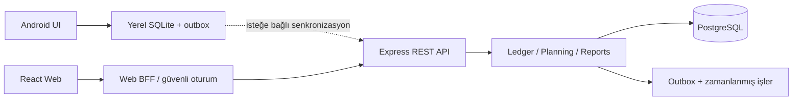

# Cep Bütçem · Mobil/Web Mimari ve Kod Rehberi

Bu rehber mevcut yerel Android uygulamasını koruyarak web ve isteğe bağlı senkronizasyon katmanı eklemek için uygulanabilir tasarımdır. Bugün Android v1.3 ve çalışan React/Tailwind arayüz referansı vardır. PostgreSQL şeması ve REST controller örnekleri hazırlanmıştır; sunuculu ürün henüz dağıtılmamıştır. Production mimarisi, çalışan arayüz örneği ve canlıya çıkış için gereken işler ayrı belirtilir.

## 1. KULLANICI DENEYİMİ VE ARAYÜZ (UI/UX) TASARIMI

### Dashboard bileşen modeli

```text
AppShell
 ├─ Header: başlık, tema, profil/ayarlar
 ├─ SalaryPeriodPicker: başlangıç günü 1–31, önceki/sonraki dönem
 ├─ BalanceCard: bugünkü kayıtlı hesap bakiyesi; banka bakiyesiyle karıştırılmaz
 ├─ IncomeExpenseCards: gerçekleşmiş gelir/gider, eşit geçen günlerle karşılaştırma
 ├─ QuickActions: Gider / Gelir
 ├─ PeriodHealthCard: harcanan gelir yüzdesi, hedef, günlük pay
 ├─ CreditCardList: her kart için ayrı ekstre / dönem içi / provizyon
 ├─ AccountCarousel: nakit/banka, bakiye ve yönetim
 ├─ UpcomingPayments: gecikenler önce, sonra vade sırası
 ├─ InsightPreview: tek eyleme dönüşen yorum, detay ekranı
 ├─ RecentTransactions: tarih grupları, en son 6 kayıt
 └─ BottomNavigation: Özet / İşlemler / Analiz / Bütçe / Ayarlar
```

Mobilde 360–430 px tek sütun; 48 dp/px dokunma alanı. ≥1024 px masaüstünde özet + sağda giriş formu; finans içerikleri 1100 px civarında sınırlandırılır. Küçük ekranlarda tutar küçülür veya satır kırar, yana taşmaz. Klavye açıldığında Kaydet erişilebilir kalır. Boş durumda sahte bakiye yerine “İlk gelirini ekle” bulunur.

**3 dokunmayla hızlı giriş:** 1) Gider düğmesi, 2) otomatik odaklı tutar alanı/son kullanılan kategori, 3) Kaydet. Tutarın klavyede yazılması ayrıca tuş vuruşları gerektirir. Varsayılan hesap, uygun kategori ve bugün seçilidir. Kategori, tarih veya açıklamayı değiştirmek isteyen kullanıcı ek etkileşim yapar; her kombinasyon için üç dokunma vaat edilmez. Tarih/açıklama “Diğer alanlar” altında; silme hızlı girişten ayrıdır. Çift Kaydet engellenir; ağ hatasında form ve aynı istek anahtarı korunur.

| Token | Açık | Koyu | Kullanım |
|---|---|---|---|
| Arka plan | `#F4F6FB` | `#0B1020` | Ana yüzey |
| Kart | `#FFFFFF` | `#121A2E` | İçerik |
| Metin | `#151A2D` | `#F8FAFC` | Tutar ve başlık |
| İkincil metin | `#68728A` | `#9EACC1` | Açıklama |
| Kenar | `#E2E7F0` | `#26334D` | Form ve ayırıcı |
| Birincil | `#007F65` | `#35D6AE` | Ana eylem, olumlu durum |
| Indigo | `#5552DF` | `#A5AEFF` | Kart takibi ve bilgi |
| Dikkat | `#9D5700` | `#F6BD60` | %50–80 kullanım |
| Yüksek | `#B42343` | `#FF8096` | %80+ kullanım |

Harcama = gider/gelir; <50 yeşil, 50–<80 sarı, ≥80 kırmızı. Gelir yoksa nötr; %100 aşımı sayıdan saklanmaz. Gösterge yayı %100'de dolar. Durum metni de bulunur; renk tek bilgi taşıyıcısı değildir. Bir saniyelik 0→gerçek yüzde animasyonu; azaltılmış hareket tercihinde doğrudan son değer. Ekran okuyucu her animasyon karesini değil son değeri okur. Gradyan bakiye ve dönem kartı aynı **seçili maaş döneminin** rengini taşır; renk hesap bakiyesinin kredi değerlendirmesi değildir.

### Somut UX kararları

- Kart ekleme özette doğrudan erişilir; ayrı hesap otomatik oluşturulabilir. Kart takibini kaldırmak alışveriş/transfer kayıtlarını korur. Hesabı ve geçmişini kalıcı silmek ayrı eylemdir; bağlı kayıt sayıları ve transfer etkisi onay ekranında gösterilir.
- Banka özeti üç bağımsız, sıfır/pozitif tutar ve güncelleme tarihi içerir. Bankanın “dönem içi” tutarı provizyonu zaten kapsıyorsa provizyon iki kez eklenmez; alan açıklaması bunu söyler. Bu özet gelir/gider kaydı değildir.
- Geçmiş dönem analizi, bugünkü banka özeti ve net varlık farklı etiketlenir. Güncel bankacılık verisi geçmiş döneme taşınmış gibi gösterilmez.
- Gerçek erişilebilirlik hedefi WCAG 2.2 AA; TalkBack, klavye ve %200 metin ölçeği doğrulanır. Görsel test tek başına erişilebilirlik sertifikası değildir.

## 2. VERİTABANI MİMARİSİ (DATABASE SCHEMA)

PostgreSQL 16+; `users`, `transactions`, `categories`, `budgets` ana tabloları; hesap ve transferleri ayrıca tutarız. UUID PK, sahipliği koruyan bileşik FK, para için BIGINT en küçük birim. API para değerlerini JSON string olarak taşır; JavaScript Number ile hesaplanmaz. Para birimleri aynı toplama karıştırılmaz. PostgreSQL DATE işlem günü, TIMESTAMPTZ sistem olayı içindir. Profildeki saat dilimi sunucuda geçerli IANA kimliği olarak doğrulanır. Android SQLite mevcut yerel kaynak olarak kalır.

Aşağıdaki dosya tek transaction içinde çalışır: [schema.sql](architecture/schema.sql).

```sql
BEGIN;
CREATE TABLE currencies (
  code CHAR(3) PRIMARY KEY CHECK (code ~ '^[A-Z]{3}$'),
  minor_digits SMALLINT NOT NULL CHECK (minor_digits BETWEEN 0 AND 6)
);
INSERT INTO currencies(code,minor_digits) VALUES ('TRY',2),('USD',2),('EUR',2),('JPY',0);
CREATE TABLE users (
  id UUID PRIMARY KEY DEFAULT gen_random_uuid(),
  email VARCHAR(254) NOT NULL UNIQUE CHECK (email = lower(btrim(email))),
  password_hash TEXT NOT NULL,
  payday SMALLINT NOT NULL DEFAULT 1 CHECK (payday BETWEEN 1 AND 31),
  timezone TEXT NOT NULL DEFAULT 'Europe/Istanbul',
  default_currency CHAR(3) NOT NULL DEFAULT 'TRY' REFERENCES currencies(code) CHECK (default_currency ~ '^[A-Z]{3}$'),
  created_at TIMESTAMPTZ NOT NULL DEFAULT now()
);
CREATE TABLE accounts (
  id UUID PRIMARY KEY DEFAULT gen_random_uuid(),
  user_id UUID NOT NULL REFERENCES users(id) ON DELETE RESTRICT,
  name VARCHAR(60) NOT NULL CHECK (length(btrim(name)) > 0),
  currency CHAR(3) NOT NULL DEFAULT 'TRY' REFERENCES currencies(code) CHECK (currency ~ '^[A-Z]{3}$'),
  opening_minor BIGINT NOT NULL DEFAULT 0,
  archived_at TIMESTAMPTZ,
  UNIQUE (id, user_id, currency)
);
CREATE TABLE categories (
  id UUID PRIMARY KEY DEFAULT gen_random_uuid(),
  user_id UUID NOT NULL REFERENCES users(id) ON DELETE RESTRICT,
  name VARCHAR(60) NOT NULL CHECK (length(btrim(name)) > 0),
  kind VARCHAR(7) NOT NULL CHECK (kind IN ('income', 'expense')),
  archived_at TIMESTAMPTZ,
  UNIQUE (id, user_id, kind),
  UNIQUE (user_id, kind, name)
);
CREATE TABLE transactions (
  id UUID PRIMARY KEY DEFAULT gen_random_uuid(),
  user_id UUID NOT NULL REFERENCES users(id) ON DELETE RESTRICT,
  account_id UUID NOT NULL,
  category_id UUID NOT NULL,
  kind VARCHAR(7) NOT NULL CHECK (kind IN ('income', 'expense')),
  amount_minor BIGINT NOT NULL CHECK (amount_minor BETWEEN 1 AND 100000000000),
  currency CHAR(3) NOT NULL DEFAULT 'TRY',
  occurred_on DATE NOT NULL CHECK (occurred_on BETWEEN DATE '2000-01-01' AND DATE '2100-12-31'),
  note VARCHAR(1000) NOT NULL DEFAULT '',
  idempotency_key UUID NOT NULL,
  request_hash CHAR(64) NOT NULL CHECK (request_hash ~ '^[0-9a-f]{64}$'),
  version BIGINT NOT NULL DEFAULT 1 CHECK (version > 0),
  deleted_at TIMESTAMPTZ,
  created_at TIMESTAMPTZ NOT NULL DEFAULT now(),
  updated_at TIMESTAMPTZ NOT NULL DEFAULT now(),
  FOREIGN KEY (account_id, user_id, currency) REFERENCES accounts(id, user_id, currency) ON DELETE RESTRICT,
  FOREIGN KEY (category_id, user_id, kind) REFERENCES categories(id, user_id, kind) ON DELETE RESTRICT,
  UNIQUE (user_id, idempotency_key)
);
CREATE INDEX transactions_period ON transactions (user_id, occurred_on DESC, id DESC) WHERE deleted_at IS NULL;
CREATE INDEX transactions_category_period ON transactions (user_id, category_id, occurred_on) WHERE deleted_at IS NULL;
CREATE TABLE budgets (
  id UUID PRIMARY KEY DEFAULT gen_random_uuid(),
  user_id UUID NOT NULL REFERENCES users(id) ON DELETE RESTRICT,
  category_id UUID NOT NULL,
  kind VARCHAR(7) NOT NULL DEFAULT 'expense' CHECK (kind = 'expense'),
  currency CHAR(3) NOT NULL DEFAULT 'TRY' REFERENCES currencies(code) CHECK (currency ~ '^[A-Z]{3}$'),
  period_start DATE NOT NULL,
  period_end DATE NOT NULL CHECK (period_end >= period_start),
  limit_minor BIGINT NOT NULL CHECK (limit_minor BETWEEN 1 AND 100000000000),
  version BIGINT NOT NULL DEFAULT 1,
  FOREIGN KEY (category_id, user_id, kind) REFERENCES categories(id, user_id, kind) ON DELETE RESTRICT,
  UNIQUE (user_id, category_id, currency, period_start)
);
-- Transfers are a separate ledger operation: never counted as income/expense.
CREATE TABLE transfers (
  id UUID PRIMARY KEY DEFAULT gen_random_uuid(),
  user_id UUID NOT NULL REFERENCES users(id) ON DELETE RESTRICT,
  source_account_id UUID NOT NULL,
  target_account_id UUID NOT NULL CHECK (target_account_id <> source_account_id),
  currency CHAR(3) NOT NULL,
  amount_minor BIGINT NOT NULL CHECK (amount_minor > 0),
  occurred_on DATE NOT NULL,
  FOREIGN KEY (source_account_id, user_id, currency) REFERENCES accounts(id, user_id, currency),
  FOREIGN KEY (target_account_id, user_id, currency) REFERENCES accounts(id, user_id, currency)
);
CREATE TABLE credit_cards (
  id UUID PRIMARY KEY DEFAULT gen_random_uuid(),
  user_id UUID NOT NULL REFERENCES users(id) ON DELETE RESTRICT,
  account_id UUID NOT NULL,
  currency CHAR(3) NOT NULL,
  closing_day SMALLINT NOT NULL CHECK (closing_day BETWEEN 1 AND 31),
  due_day SMALLINT NOT NULL CHECK (due_day BETWEEN 1 AND 31),
  archived_at TIMESTAMPTZ,
  FOREIGN KEY (account_id,user_id,currency) REFERENCES accounts(id,user_id,currency),
  UNIQUE (account_id,user_id),
  UNIQUE (id,user_id,currency)
);
CREATE TABLE card_snapshots (
  id UUID PRIMARY KEY DEFAULT gen_random_uuid(),
  user_id UUID NOT NULL REFERENCES users(id) ON DELETE RESTRICT,
  card_id UUID NOT NULL,
  currency CHAR(3) NOT NULL,
  statement_minor BIGINT NOT NULL CHECK (statement_minor BETWEEN 0 AND 100000000000),
  current_minor BIGINT NOT NULL CHECK (current_minor BETWEEN 0 AND 100000000000),
  pending_minor BIGINT NOT NULL CHECK (pending_minor BETWEEN 0 AND 100000000000),
  as_of_date DATE NOT NULL,
  created_at TIMESTAMPTZ NOT NULL DEFAULT now(),
  FOREIGN KEY (card_id,user_id,currency) REFERENCES credit_cards(id,user_id,currency)
);
CREATE INDEX card_snapshots_latest ON card_snapshots(user_id,card_id,created_at DESC,id DESC);
CREATE TABLE auth_sessions (
  id UUID PRIMARY KEY DEFAULT gen_random_uuid(),
  user_id UUID NOT NULL REFERENCES users(id) ON DELETE CASCADE,
  family_id UUID NOT NULL,
  refresh_hash CHAR(64) NOT NULL UNIQUE,
  expires_at TIMESTAMPTZ NOT NULL,
  consumed_at TIMESTAMPTZ,
  revoked_at TIMESTAMPTZ,
  created_at TIMESTAMPTZ NOT NULL DEFAULT now()
);
COMMIT;

```

`(account_id, user_id, currency)` ve `(category_id, user_id, kind)` FK'leri, yalnızca bir kimliğin varlığını değil aynı kullanıcı ve uygun tür/para birimini de doğrular. Arşivleme geçmişi korur; kalıcı hesap silme ayrı, açık onaylı operasyon olur. Sunucuda tüm yazma işlemlerini transaction + audit olayı ile yürüt; kullanıcı silme/veri saklama politikasını ayrıca belirle. Değişiklikleri numaralı migration dosyalarıyla dağıt, şemayı her açılışta yeniden oluşturma.

**Maaş dönemi:** 15 Ekim→14 Kasım; 31→kısa ayın son günü→sonraki ay tekrar 31. Dönem PK'sı yerine başlangıç/bitiş DATE tutulur; maaş günü sonradan değiştirilince geçmiş bütçe tarihleri sessizce yeniden yazılmaz. Gerçekleşmiş analizde üst sınır `min(dönem sonu, kullanıcının bugünü)`; planlananlar ayrı listelenir.

Bakiye = açılış + gelir − gider + transfer giriş − transfer çıkış. Açılış gelir değildir. Kart ödemesi transferdir; ekstre toplamını ayrıca gider olarak eklemek çift sayımdır.

## 3. ARKA YÜZ (BACKEND REST API) MİMARİSİ

Başlangıç: Node 24 + Express 5 + PostgreSQL; modüler tek servis. Erken mikroservis yerine sınırları net modüller: `auth`, `ledger`, `planning`, `reports`, `insights`, `sync`. Controller doğrular; service transaction ve iş kuralını yürütür; repository parametreli SQL kullanır. Android internetsiz çalışmaya devam eder; kullanıcı istemeden finans verisi buluta taşınmaz.

Mevcut Android sınırları: `Finance` saf hesaplama, `Planning` kart/fatura ve doğrulama, `Ledger` veritabanı ve atomic servis işlemleri, `Design` görsel bileşenler, `MainActivity` ekran akışıdır. Sunuculu sürüme geçerken ekranları ayrı ViewModel/view sınıflarına böl; SQLite→sunucu senkronizasyonunu UI event handler'larına koyma. Kullanıcıya kayıtların yerel mi, eşitlenmiş mi, çatışmalı mı olduğunu açıkça göster.



| Metot / endpoint | Controller mantığı | Sonuç |
|---|---|---|
| `POST /v1/auth/register` | E-posta normalize; şifre Argon2id; kullanıcı + varsayılan hesap/kategori atomic | 201; e-posta doğrulama production'da eklenir |
| `POST /v1/auth/login` | Generic hata; dummy hash ile bilinmeyen e-postada da hash doğrulama; kısa ömürlü JWT | 200 / 401 |
| `POST /v1/auth/refresh` | Refresh hash + session family; `SELECT FOR UPDATE`; tek kullanımlı rotasyon; reuse'da aileyi iptal | 200 / 401; ileri uygulama |
| `POST /v1/auth/logout` | Session family iptal; web cookie temizle | 204; ileri uygulama |
| `GET /v1/accounts` | JWT kullanıcıya ait hesaplar ve gerçekleşmiş bakiyeler | 200 |
| `GET /v1/categories?kind=expense` | Sahiplik, tür, arşiv filtresi | 200 |
| `POST /v1/transactions` | DTO, sahiplik, kategori türü, para birimi, idempotency kontrolü | 201; aynı istek 200; farklı payload 409 |
| `GET /v1/transactions?from=...&to=...&categoryId=...` | DATE doğrulama; max100; tarih+UUID imleci; yalnızca JWT kullanıcısı | 200 |
| `PUT /v1/transactions/:id` | Sahiplik + version; optimistic concurrency; eski version üzerine yazma yok | 200 / 409 |
| `DELETE /v1/transactions/:id` | Sahiplik + `If-Match` version; soft delete | 204 / 409 |
| `POST /v1/budgets` | Expense kategorisi, server maaş dönemi, para birimi, pozitif limit | 201 |
| `PUT /v1/budgets/:id` / `DELETE ...` | Sahiplik + version; açık kapsam | 200 / 204 |
| `GET /v1/reports/monthly?month=2026-10&currency=TRY` | `month` maaş döneminin başladığı ay; server payday ve timezone ile tarihleri çıkarır | 200 |
| `GET /v1/budgets/status?month=2026-10` | Aynı dönem/para biriminde gider; kalan, %80 uyarı, aşım | 200 |

İstek body’sinde `user_id` kabul etme. Kaynağı yalnızca doğrulanmış JWT `sub` alanıdır. 400/422 alan hatası, 401 oturum, 409 çatışma; başka kullanıcı kayıtları için detay sızdırma. Örnek controller'lar [controllers.mjs](architecture/controllers.mjs): register/login + JWT middleware + işlem CRUD; rapor sorguları [reports.sql](architecture/reports.sql). Diğer endpoint'ler yol haritasındaki service/controller işleri olarak listelenmiştir.

### JWT / servis bootstrap

```js
import express from 'express';
import helmet from 'helmet';
import { rateLimit } from 'express-rate-limit';
import { Pool, types } from 'pg';
import { SignJWT, importPKCS8, importSPKI } from 'jose';
import { createRouter, requireAuth } from './controllers.mjs';
import { readFile } from 'node:fs/promises';
import * as argon2 from 'argon2';

// DATE gününü JS saat dilimine kaydırma; BIGINT string varsayılanını koru.
types.setTypeParser(1082, value => value);
const pool = new Pool({ connectionString: process.env.DATABASE_URL, max: 10 });
const privateKey = await importPKCS8(await readFile(process.env.JWT_PRIVATE_KEY_PATH,'utf8'),'RS256');
const publicKey = await importSPKI(await readFile(process.env.JWT_PUBLIC_KEY_PATH,'utf8'),'RS256');
const issuer = process.env.JWT_ISSUER, audience = 'cep-butcem';
const signAccess = userId => new SignJWT({})
  .setProtectedHeader({alg:'RS256',kid:process.env.JWT_KEY_ID})
  .setSubject(userId).setIssuer(issuer).setAudience(audience)
  .setIssuedAt().setExpirationTime('10m').sign(privateKey);
const dummyPasswordHash = await argon2.hash('startup-dummy-not-a-user-password',
  {type:argon2.argon2id,memoryCost:65536,timeCost:3,parallelism:1});
const app = express();
app.disable('x-powered-by');
app.use(helmet());
app.use(express.json({limit:'32kb'}));
app.use('/v1/auth',rateLimit({windowMs:15*60*1000,limit:20}));
app.use('/v1',createRouter({pool,auth:requireAuth(publicKey,issuer,audience),signAccess,dummyPasswordHash}));
// Production error middleware: Zod->422, FK->422, generic500; secrets/body loglanmaz.
// Proxy trust yalnızca bilinen ingress için ayarlanır. TLS ve limitler ingress'te de vardır.
app.use((error,req,res,next) => {
  const status = error.name === 'ZodError' ? 422 : (error.status ?? 500);
  res.status(status).json({error: status >= 500 ? 'İşlem tamamlanamadı.' : error.message});
});
app.listen(Number(process.env.PORT ?? 3000));
```

Bu bootstrap/controller **referansıdır**, üretime dağıtılmış veya uçtan uca sınanmış bir backend değildir. `npm install express@5 pg jose zod argon2 helmet express-rate-limit`, ardından seçilen sürümleri lockfile'a sabitle. Migration, secrets, TLS, email verification, refresh/logout ve integration testlerini 2. sprintte tamamla. PEM ve DATABASE_URL git'e yazılmaz; secret manager/volume kullanılır. Managed PostgreSQL'de TLS sertifikası doğrulanır, `rejectUnauthorized:false` kullanılmaz.

Webde BFF access token'ı sunucuda tutar; tarayıcıya `HttpOnly; Secure; SameSite` oturum cookie'si verilir. Cookie ile yazma istekleri Origin + CSRF token ile korunur; JWT localStorage'a konmaz. Mobilde refresh token Android Keystore destekli şifreli depoda; access token bellekte. Sunucu refresh token'ın yalnızca hash'ini saklar, rotasyon tekrar kullanımını tespit eder. Logout sonrası mevcut access token en fazla 10 dakika geçerli kalabilir; anlık iptal gerekiyorsa JWT session kimliği ve sunucuda revocation kontrolü eklenir. JWT `alg`, `iss`, `aud`, `exp`, `sub` zorunlu; key rotation için `kid`. CORS yalnızca izinli origin'ler; JWT kullanıcı başına yetkilendirmenin yerine geçmez.

### Rapor ve bütçe hesaplaması

```sql
-- Income/expense report parameters: user UUID, from DATE, to DATE, currency, user timezone.
SELECT
  coalesce(sum(amount_minor) FILTER (WHERE kind='income'), 0)::text AS income_minor,
  coalesce(sum(amount_minor) FILTER (WHERE kind='expense'), 0)::text AS expense_minor
FROM transactions
WHERE user_id=$1 AND deleted_at IS NULL AND currency=$4
  AND occurred_on BETWEEN $2 AND least($3::date, (now() AT TIME ZONE $5)::date);

-- Category report, including budgets with zero expenses.
-- Same parameters; use the user's salary-period start/end from the server.
WITH spending AS (
  SELECT category_id, sum(amount_minor) AS used
  FROM transactions
  WHERE user_id=$1 AND deleted_at IS NULL AND kind='expense' AND currency=$4
    AND occurred_on BETWEEN $2 AND least($3::date, (now() AT TIME ZONE $5)::date)
  GROUP BY category_id
)
SELECT c.id, c.name, coalesce(s.used,0)::text AS used_minor,
  b.limit_minor::text,
  CASE WHEN b.id IS NULL THEN NULL ELSE (b.limit_minor-coalesce(s.used,0))::text END AS remaining_minor,
  CASE WHEN b.id IS NULL THEN 'no_budget'
       WHEN coalesce(s.used,0)>b.limit_minor THEN 'exceeded'
       WHEN coalesce(s.used,0)*100>=b.limit_minor*80 THEN 'near_limit'
       ELSE 'within_limit' END AS status
FROM categories c
LEFT JOIN spending s ON s.category_id=c.id
LEFT JOIN budgets b ON b.category_id=c.id AND b.user_id=$1 AND b.currency=$4
  AND b.period_start=$2 AND b.period_end=$3
WHERE c.user_id=$1 AND c.kind='expense' AND (c.archived_at IS NULL OR s.used IS NOT NULL OR b.id IS NOT NULL)
ORDER BY coalesce(s.used,0) DESC,c.id;

```

`income_minor`, `expense_minor`, `used_minor` JSON string kalır. Tasarruf `(gelir−gider)/gelir`; gelir0 ise null. Ayrı para birimleri ayrı raporlanır. Bütçesi olmayan kategoriler `no_budget`; %80 yakın uyarı, limit üstü aşım. Banka özeti bu sorgulara eklenmez.

## 4. ÖN YÜZ (FRONTEND) VE KOD ÖRNEKLERİ

Çalışan [web-reference](../web-reference/README.md): React 19 + Vite 7 + Tailwind 4. Android uygulaması Java/SQLite kalır; bu web örneği API sınırını gösterir, Android verilerine bağlanmaz. Örnekte kayıtlar React state'tedir ve yenilemede temizlenir. Gerçek API adapter'ında kategori/hesap UUID'lerini server'dan al; auth BFF üzerinden yürüt.

```sh
cd web-reference
npm ci
npm test
npm run build
npm run dev
```

Bileşen sözleşmesi:

```js
// API'ye bağlanırken onSave'i değiştir; form aynı kalır.
async function onSave(payload, idempotencyKey) {
  const response = await fetch('/bff/transactions', {
    method:'POST', credentials:'same-origin',
    headers:{'Content-Type':'application/json','Idempotency-Key':idempotencyKey,'X-CSRF-Token':csrfToken},
    body:JSON.stringify({...payload,accountId:selectedAccountId,currency:'TRY'})
  });
  if (!response.ok) throw new Error('Kayıt tamamlanamadı; form korunuyor.');
  const saved = await response.json();
  // BFF server cevabını camelCase DTO'ya map eder; id ile tekilleştir.
  setTransactions(previous => [saved,...previous.filter(t => t.id !== saved.id)]);
}
```

Hesap seçimi form dışında değişirse `TransactionForm key={selectedAccountId}` ile yeni form/idempotency bağlamı oluştur; aynı anahtar farklı hesaba taşınmaz.

`finance.js` Türkçe tutarı BigInt kuruşa çevirir; veriyi JSON string taşır. Sonuçlar matematiksel olarak kuruş seviyesinde tamdır. Tarih tam ISO doğrulanır; kısa ay ve 31. gün desteklenir. Transfer ve gelecek tarih gerçekleşmiş giderde sayılmaz.

### İşlem Ekleme bileşeni

```jsx
import React, { useId, useRef, useState } from "react";
import { isDate, parseMinor, todayISO } from "./finance.js";
export function TransactionForm({
  categories,
  onSave,
  onCancel,
  initialKind = "expense",
}) {
  const [kind, setKind] = useState(initialKind),
    [amount, setAmount] = useState("");
  const [categoryId, setCategory] = useState(
    categories.find((c) => c.kind === initialKind)?.id ?? "",
  );
  const [occurredOn, setDate] = useState(todayISO()),
    [note, setNote] = useState("");
  const [busy, setBusy] = useState(false),
    [error, setError] = useState("");
  const retry = useRef(null);
  const errorId = useId();
  const control =
    "w-full rounded-xl border border-slate-200 bg-white px-4 py-3 text-base dark:border-slate-700 dark:bg-slate-900 focus:outline-2 focus:outline-teal-500";
  async function submit(event) {
    event.preventDefault();
    setError("");
    try {
      if (
        !categoryId ||
        !categories.some((c) => c.id === categoryId && c.kind === kind)
      )
        throw new Error("Uygun bir kategori seç.");
      if (!isDate(occurredOn))
        throw new Error("2000–2100 arasında geçerli bir tarih seç.");
      const payload = {
        kind,
        amountMinor: parseMinor(amount),
        categoryId,
        occurredOn,
        note: note.trim(),
      };
      const fingerprint = JSON.stringify(payload);
      if (retry.current?.fingerprint !== fingerprint)
        retry.current = { fingerprint, key: crypto.randomUUID() };
      setBusy(true);
      await onSave(payload, retry.current.key);
      retry.current = null;
      setAmount("");
      setNote("");
      setKind(initialKind);
      setCategory(categories.find((c) => c.kind === initialKind)?.id ?? "");
    } catch (failure) {
      setError(
        failure instanceof Error
          ? failure.message
          : "Kaydedilemedi. Tekrar dene.",
      );
    } finally {
      setBusy(false);
    }
  }
  return (
    <form onSubmit={submit} className="space-y-4">
      <fieldset disabled={busy} className="space-y-4 disabled:opacity-70">
        <legend className="mb-4 text-xl font-bold">Hızlı işlem ekle</legend>
        <div className="grid grid-cols-2 gap-2" aria-label="İşlem türü">
          {[
            ["expense", "Gider"],
            ["income", "Gelir"],
          ].map(([value, label]) => (
            <button
              key={value}
              type="button"
              aria-pressed={kind === value}
              onClick={() => {
                setKind(value);
                setCategory(categories.find((c) => c.kind === value)?.id ?? "");
              }}
              className={`min-h-12 rounded-xl font-semibold ${kind === value ? "bg-teal-700 text-white" : "bg-slate-100 dark:bg-slate-800"}`}
            >
              {label}
            </button>
          ))}
        </div>
        <label className="block text-sm font-medium">
          Tutar · TL
          <input
            autoFocus
            inputMode="decimal"
            required
            value={amount}
            onChange={(e) => setAmount(e.target.value)}
            placeholder="0,00"
            className={`${control} mt-2 text-2xl font-bold`}
            aria-describedby={error ? errorId : undefined}
          />
        </label>
        <label className="block text-sm font-medium">
          Kategori
          <select
            required
            value={categoryId}
            onChange={(e) => setCategory(e.target.value)}
            className={`${control} mt-2`}
          >
            <option value="" disabled>
              Seç
            </option>
            {categories
              .filter((c) => c.kind === kind)
              .map((c) => (
                <option key={c.id} value={c.id}>
                  {c.name}
                </option>
              ))}
          </select>
        </label>
        <details className="rounded-xl bg-slate-50 p-3 dark:bg-slate-800">
          <summary className="min-h-8 cursor-pointer text-sm">
            Tarih ve açıklama · isteğe bağlı
          </summary>
          <div className="mt-3 space-y-3">
            <label className="block text-sm">
              Tarih
              <input
                required
                type="date"
                min="2000-01-01"
                max="2100-12-31"
                value={occurredOn}
                onChange={(e) => setDate(e.target.value)}
                className={`${control} mt-1`}
              />
            </label>
            <label className="block text-sm">
              Açıklama
              <textarea
                maxLength={1000}
                value={note}
                onChange={(e) => setNote(e.target.value)}
                className={`${control} mt-1`}
                rows={2}
              />
            </label>
          </div>
        </details>
        {error && (
          <p
            id={errorId}
            role="alert"
            className="rounded-xl bg-rose-50 p-3 text-sm text-rose-800 dark:bg-rose-950 dark:text-rose-200"
          >
            {error}
          </p>
        )}
        <button
          type="submit"
          className="min-h-12 w-full rounded-xl bg-teal-700 px-5 py-3 font-bold text-white hover:bg-teal-800"
        >
          {busy ? "Kaydediliyor…" : "Kaydet"}
        </button>
        {onCancel && (
          <button
            type="button"
            onClick={onCancel}
            className="min-h-12 w-full rounded-xl border border-slate-300 dark:border-slate-700"
          >
            Vazgeç
          </button>
        )}
      </fieldset>
    </form>
  );
}

```

### Aylık/Maaş Dönemi Özet Listesi

```jsx
import React, { useEffect, useState } from "react";
import { band, money, summarize, todayISO } from "./finance.js";
function useAnimatedRatio(target) {
  const [value, setValue] = useState(0);
  useEffect(() => {
    if (
      target === null ||
      window.matchMedia("(prefers-reduced-motion: reduce)").matches
    ) {
      setValue(target);
      return;
    }
    let frame, start;
    setValue(0);
    function tick(time) {
      start ??= time;
      const progress = Math.min(1, (time - start) / 1000);
      setValue(target * (1 - (1 - progress) ** 3));
      if (progress < 1) frame = requestAnimationFrame(tick);
    }
    frame = requestAnimationFrame(tick);
    return () => cancelAnimationFrame(frame);
  }, [target]);
  return value;
}
const surfaces = {
  safe: "from-emerald-800 to-teal-700",
  watch: "from-amber-800 to-yellow-700",
  high: "from-rose-900 to-red-700",
  unknown: "from-indigo-800 to-blue-800",
};
const labels = {
  safe: "Dengede",
  watch: "Dikkat",
  high: "Yüksek harcama",
  unknown: "Gelir bekleniyor",
};
export function PeriodSummary({ transactions, categories, from, to }) {
  const today = todayISO(),
    { income, expense, net, ratio } = summarize(transactions, from, to, today);
  const state = band(ratio),
    animated = useAnimatedRatio(ratio);
  const names = new Map(categories.map((c) => [c.id, c.name]));
  const list = transactions
    .filter((t) => t.occurredOn >= from && t.occurredOn <= to)
    .toSorted(
      (a, b) =>
        b.occurredOn.localeCompare(a.occurredOn) ||
        (b.createdAt ?? "").localeCompare(a.createdAt ?? ""),
    )
    .slice(0, 6);
  return (
    <section aria-label="Maaş dönemi özeti" className="space-y-5">
      <div
        className={`rounded-3xl bg-linear-to-br ${surfaces[state]} p-6 text-white shadow-lg`}
      >
        <div className="flex flex-wrap items-center justify-between gap-2">
          <p className="text-sm font-medium">Maaş dönemi dengesi</p>
          <span className="rounded-full bg-white/15 px-3 py-1 text-xs font-bold">
            {labels[state]}
          </span>
        </div>
        <p className="mt-3 break-words text-4xl font-bold tracking-tight">
          {money(net)}
        </p>
        <p className="mt-2 text-xs text-white/85">
          {from} — {to} · Gelir − gider; banka bakiyesi değildir.
        </p>
        <div className="mt-5 flex items-end justify-between gap-2">
          <span className="text-sm">Gelirin harcanan kısmı</span>
          <span aria-hidden="true" className="text-2xl font-bold">
            {animated === null
              ? "—"
              : `%${(animated ?? 0).toLocaleString("tr-TR", { maximumFractionDigits: 1, minimumFractionDigits: 1 })}`}
          </span>
          <span className="sr-only">
            {ratio === null ? "Gelir kaydı gerekli" : `Yüzde ${ratio}`}
          </span>
        </div>
        <div
          aria-hidden="true"
          className="mt-2 h-2 overflow-hidden rounded-full bg-white/20"
        >
          <div
            className="h-full rounded-full bg-white"
            style={{ width: `${Math.min(100, Math.max(0, animated ?? 0))}%` }}
          />
        </div>
      </div>
      <div className="grid grid-cols-2 gap-3">
        {[
          ["Gelir", income, "text-teal-700 dark:text-teal-300"],
          ["Gider", expense, "text-rose-700 dark:text-rose-300"],
        ].map(([title, value, color]) => (
          <div
            key={title}
            className="rounded-2xl border border-slate-200 bg-white p-4 dark:border-slate-800 dark:bg-slate-900"
          >
            <p className="text-sm text-slate-500 dark:text-slate-400">
              {title}
            </p>
            <p className={`mt-2 break-words text-xl font-bold ${color}`}>
              {money(value)}
            </p>
          </div>
        ))}
      </div>
      <div className="rounded-2xl border border-slate-200 bg-white p-5 dark:border-slate-800 dark:bg-slate-900">
        <h2 className="text-lg font-bold">Son işlemler</h2>
        {!list.length && (
          <p className="mt-3 text-sm text-slate-500 dark:text-slate-400">
            İlk gelir veya giderini ekleyerek başla.
          </p>
        )}
        <ul className="mt-2 divide-y divide-slate-100 dark:divide-slate-800">
          {list.map((t) => (
            <li
              key={t.id}
              className="flex items-center justify-between gap-3 py-3"
            >
              <div className="min-w-0">
                <p className="font-medium">
                  {names.get(t.categoryId) ?? "Diğer"}
                </p>
                <p className="text-xs text-slate-500 dark:text-slate-400">
                  {t.occurredOn}
                  {t.occurredOn > today ? " · Planlanan" : ""}
                </p>
                {t.note && (
                  <p className="truncate text-sm text-slate-500 dark:text-slate-400">
                    {t.note}
                  </p>
                )}
              </div>
              <p
                className={`shrink-0 font-semibold ${t.kind === "income" ? "text-teal-700 dark:text-teal-300" : "text-rose-700 dark:text-rose-300"}`}
              >
                {t.kind === "income" ? "+" : "−"}
                {money(t.amountMinor)}
              </p>
            </li>
          ))}
        </ul>
      </div>
    </section>
  );
}

```

Tailwind kurulumu `vite.config.js` ve `styles.css` dosyalarındadır. Mobil dialog native `<dialog>` ile odağı hapseder ve Escape ile kapanır; `onSave` yalnızca başarıda kapatır. Masaüstünde form görünür sağ paneldir. API hatasında aynı payload aynı idempotency anahtarını kullanır; kullanıcı payload değiştirirse yeni anahtar oluşur. Web referansı ilk iki bileşenin çalışan örneğidir; kimlik doğrulama, kalıcı storage ve offline sync daha sonra uygulanır.

## 5. GELİŞMİŞ ÖZELLİKLER VE GELECEK PLANLAMASI (MVP+)

### Yinelenen işlemler

`recurring_rules`: user/account/category, kind, amount_minor, currency, anchor_day1–31, next_due DATE, active, timezone. `occurrences`: rule_id + original_due_date UNIQUE. Günlük job due rule'ları `FOR UPDATE SKIP LOCKED` alır; expense/income + occurrence + next_due + outbox aynı transaction'da commit edilir. Çöken/retry worker aynı vade için ikinci kayıt oluşturmaz. Ay sonuna sıkıştırdıktan sonra **anchor_day** kaybolmaz (31→29→31). Eski due tarihini düzenlerken “yalnız bu kayıt / sonraki kayıtlar” açık ayrılır. Tarih kullanıcı saat dilimindedir. Ödemesi doğrulanmayan fatura sırf vadesi geldi diye ödenmiş gösterilmez.

### Açıklanabilir AI benzeri asistan

Önce kurallı/istatistiksel katman; kullanıcı başına model veya LLM zorunlu değildir. Banka şifreleri gerekmez.

```text
comparableDays = min(geçen maaş dönemi günü, önceki dönemin gün sayısı)
variableExpense = actualExpense - paidTrackedBills
forecast = variableExpense / elapsedDays * periodDays
         + paidTrackedBills + dueUnpaidBills
savingTarget = recordedIncome * targetPercent / 100
safeDailyAllowance = max(0, recordedIncome - actualExpense
                        - dueUnpaidBills - savingTarget) / remainingDays
```

Gelecekteki maaş varsayılmaz. Kart ödemesi gider değildir. İlk7 günde tahmin düşük güven etiketi taşır. Baseline yoksa “%artış” uydurulmaz; yakın dönem kategori payı açıklanır. Her öneri `evidence`, `period`, `assumptions`, `estimatedSavingMinor`, `confidence` taşır. Gıda/sağlık gibi zorunlu harcamalar için otomatik kesin kesinti önerisi verilmez. Kullanıcının aksiyonundan önce sistem finansal kayıt yaratmaz.

### Sıradışı, uygulanabilir ürün fikirleri

1. **Satın almadan önce dene:** “Bu 900 TL harcamayı yaparsam maaşa kadar günlük payım ne olur?” Gerçek kayıt oluşturmayan what-if simülasyonu; hesaplama paneli varsayımlarını gösterir. Normal akışa dönünce gerçek bilanço aynıdır.
2. **Bütçenin zaman maliyeti:** Kaydedilmiş maaş ve kullanıcının seçtiği çalışma saatine göre alışverişi “X saatlik gelir” olarak göster; varsayılan saat uydurma. Matematik kuruşla, açıklama tahmini.
3. **Sessiz abonelik dedektifi:** Aynı not/işyeri + yakın tutar + yaklaşık aylık tarih tekrarı; “tekrar olabilir” önerisi. Kullanıcı onaylamadan recurring kural oluşturma.
4. **Harcamasız gün değil, esnek gün:** Büyük faturayı bir günde ödemeyi başarısızlık gibi boyamadan sabit/isteğe bağlı giderleri ayıran harita filtresi. Finansal toplam değişmez.
5. **Banka özeti fark kontrolü:** Kartın manuel snapshot tarihindeki kesinleşmiş borç ile aynı günün kayıtlı kart hesabını karşılaştır; “muhtemel eksik kayıt” öner. Tek tuş otomatik düzeltme yerine kullanıcıya farkın kaynağını incelet.
6. **Maaş dönemi kapanış mektubu:** Üç açıklanabilir bulgu, bir senaryo, bir sonraki dönem hedefi; karşılaştırılan gün sayısını belirt. Sonradan kaydedilen işlem raporu yeniden hesaplatır, eski export tarihli sürüm olarak kalır.

Bunlar yol haritası fikirleridir; Android v1.3'te uygulanmış gibi gösterilmez. v1.3'te gerçek olanlar ortak risk renkleri, animasyon, manuel kart özeti, hesap/kart yönetimi ve mevcut açıklanabilir asistandır.

### Çoklu para birimi

Şemadaki `currencies(code,minor_digits)` altyapısı hazır; TRY/USD/EUR için2, JPY için0. `fx_rates(base,quote,rate NUMERIC(24,12),as_of,provider)`; `UNIQUE(base,quote,as_of,provider)`. Orijinal `amount_minor` ve currency değişmez. Base rapor için işlem tarihindeki kur, kur tarihi/kaynağı ve yuvarlama yöntemi sabitlenir. Kur yoksa sessiz1 kullanma; dönüşmemiş tutarı ayrıca göster. Cross-currency transferde kaynak/ hedef tutarlar + kullanılan kur + ücret ayrı saklanır. Güncel varlık değerlemesi ile geçmiş gelir/gider çevirisi farklı raporlardır. API hesaplamasında Decimal, istemcide decimal/BigInt ölçeği; binary float para toplamı yok.

## 6. ADIM ADIM YOL HARİTASI

Dört hafta tek geliştirici için odaklanmış web/senkronizasyon MVP planıdır; tüm MVP+ fikirleri dört haftaya sıkıştırılmaz. Takvim süre tahminidir; çıkış kriterleri sağlanmadan bir sonraki aşamaya geçilmez.

| Sprint | İşler | Somut çıktı / çıkış kriteri |
|---|---|---|
| **Hafta1 · Tasarım ve domain** | Ekran akışları/tokens, para/tarih DTO'ları, PostgreSQL migrations, mobil-first form, parity fixture'ları | Android ve web aynı maaş dönemini/kuruşu hesaplar; gelir yokluğu ve %100 aşımı testlidir; şema constraints ve iki tenant senaryosu geçer |
| **Hafta2 · Güvenli API** | JWT signing/verification, refresh rotasyonu, register/email doğrulama, ledger CRUD, bütçe endpoint'leri, integration testleri | Aynı istek iki gider üretmez; yanlış tenant erişimi başarısız; token reuse aileyi iptal eder; 409 çatışması veri kaybı oluşturmaz |
| **Hafta3 · Entegrasyon ve deneyim** | React BFF, kalıcı formlar, raporlar, outbox/local UUID mapping, opt-in Android sync, bank snapshot modeli | Offline ekle→yeniden bağlan tek kayıt; düzenleme çatışması kullanıcıya gösterilir; web390px/desktop1280px, klavye/TalkBack ve büyütülmüş metin kontrolleri |
| **Hafta4 · Production ve beta** | CI/CD, staging migration, CSP/TLS, kullanıcı verisi yaşam döngüsü, backup restore drill, monitoring, Android release signing | Clean checkout build; restore denenmiş; secrets repo dışında; loglarda finans notu/token yok; kontrollü beta ve ölçümler; production deploy ayrıca onaylı |

### Dağıtım rehberi / production kapısı

- CI: `npm ci` + test/build + dependency audit; Gradle unit/lint/assemble + Android integration; migration/tenant/idempotency/refresh senaryoları PostgreSQL test instance'ta. Controller syntax check bir API integration testi değildir.
- Migration job API'den önce yalnızca bir kere çalışır; başarısız migration rollout'u durdurur. App kullanıcı rolü migration sahibi/superuser değildir. Pool limitleri total instance sayısıyla birlikte planlanır.
- Web statik dosyaları CDN; BFF ve API containerları non-root; managed PostgreSQL özel ağda TLS; secret manager, health/readiness checks, güvenli connection pooling. Uygulama veritabanı internetten herkese açılmaz.
- CORS origin listesi, CSRF, CSP, ingress/body/login rate limit, RS256 key rotation, e-posta doğrulama, session revoke ve parola sıfırlama tamamlanır. Günlüklere password/JWT/finans açıklaması yazılmaz.
- Backup/PITR yanında gerçek geri yükleme denemesi; hedef RPO/RTO ölçülür. Metrics: error rate, latency, sync conflict, duplicate reject; kişisel tutarlardan analytics türetmek ayrıca opt-in/politika gerektirir.
- Android'de sabit release keystore, signed APK/AAB, sürüm ve migration politikası; debug APK üretim dağıtımı olarak etiketlenmez. Keystore ve parolası dışarıda; v1.3 indirme hâlâ kişisel kullanım debug sürümüdür.
- Birinci üretim versiyonunda AI yorumları çevrimdışı/kurallı kalabilir. LLM ileride opt-in, veri minimizasyonu ve sağlam sayısal temel ile eklenir; model kesin para hesabının kaynağı olmaz.

### Bu teslimin doğrulama kapsamı

Android build, unit/SQLite testleri ve APK güncelleme/UI akışı `docs/VALIDATION.md` dosyasındadır. React helper testleri, Vite production build ve Chromium mobil/masaüstü akışları doğrulanır. SQL şeması, sahiplik FK'leri, tutar/istek kısıtları ve rapor sorguları PGlite PostgreSQL motorunda denenmiştir; gerçek uzak PostgreSQL/TLS, JWT oturumları, refresh/email ve production deployment bu teslimde çalıştırılmamıştır.
