# v1.8.2 · Ödeme bildirimi ve analiz geçişi

## v1.8.2 · Ödeme bildirimi ve sabit analiz konumu

- Son ödeme günü bildirimi zil simgesi ve **🔔 Son ödeme günü** başlığı taşır. Metin: “Bugün Elektrik son ödeme günü lütfen kontrol ediniz!”, iki ödemede “Elektrik ve Su”, üç ödemede “Elektrik, Su ve İnternet”. Fatura, kredi ve kart adları kullanılır. Yalnızca bugün vadesi gelenler bu cümlede birleşir; diğer tarihler ayrıntılarda kalır.
- Bildirim genişletilince tam cümle ve ödeme ayrıntıları okunur. Değişmeyen bildirim tekrar gönderilmez; ödeme listesi değişirse aynı bildirim güncellenir. Hatırlatma için **Ayarlar → Ödeme bildirimleri → Ödeme hatırlatmalarını aç** ve Android bildirim izni gerekir.
- Analiz → Gelir/Gider kategorilerini göster geçişi sayfayı en üste götürmez; kaydırma konumu ilk çizimden önce korunur.

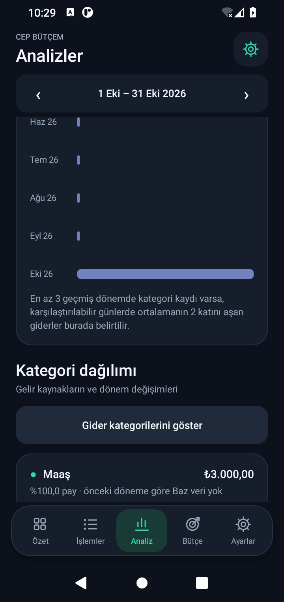

# v1.8.1 · Kartla bütünleşen ibre

## v1.8.1 · Kartla bütünleşen ibre

İbre görünümündeki ayrı açık/koyu panel kaldırıldı; ana finans kartının zemini devam eder. Beyaz ibre, yüzde ve metinler iki temada da okunur. Yeşil/sarı/kırmızı dilimlerin ince koyu sınırı kartın risk rengiyle karışmalarını önler. Oran hesabı ve 3,5 saniyelik animasyon korunur.

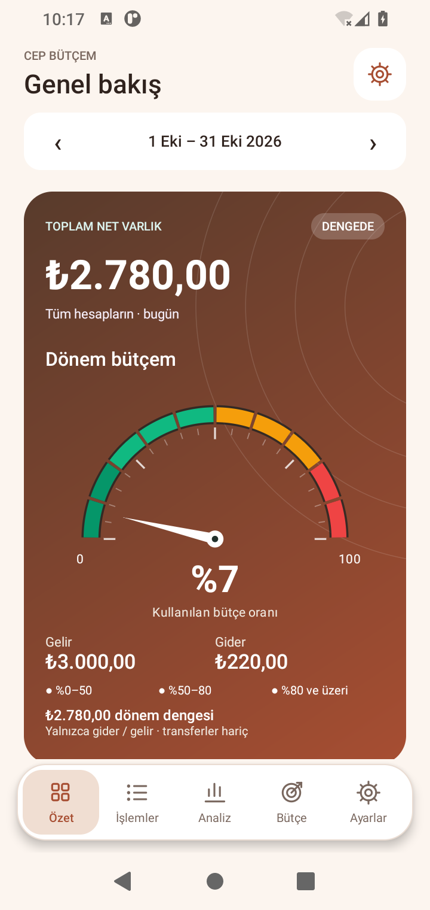

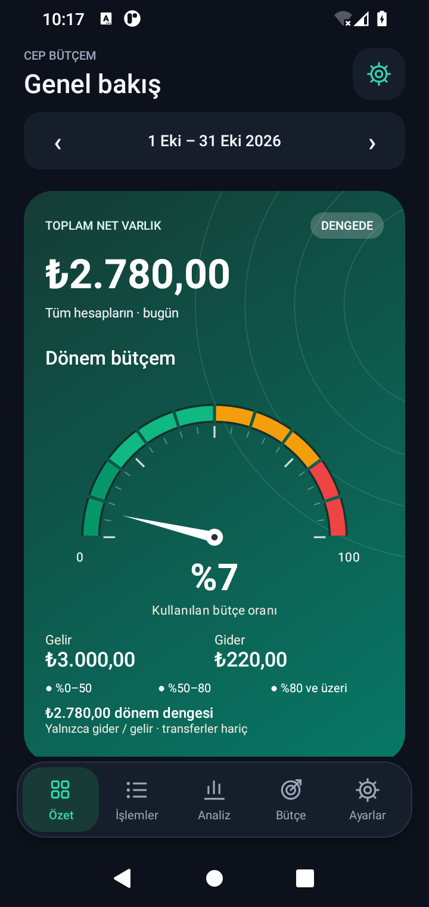

## Önceki sürüm

# v1.8 · Bütçe göstergeleri ve kişisel planlama

## v1.8 · App.jsx göstergeleri ve kişisel planlama

- **App.jsx bütçe göstergesi:** güncel App.jsx'teki 128×128 üç renkli halka; %0–50 yeşil, %50–80 sarı, %80–100 kırmızı dilimler, aynı çizgi kalınlığı ve 3,5 saniyelik ease-out-cubic animasyon. **Ayarlar → Maaş dönemi ve görünüm → Yarım daire ibreye geç** ile ilk referanstaki 320×235 ibreyi seçebilirsin: 10 renk dilimi, 21 çizgi ve üçgen ibre. İki görünümde de gerçek gider/gelir oranı kullanılır; transferler hariçtir. %100'ün üstünde sayı gerçek oranı gösterir, çizim sınırda kalır. Gelir yoksa “—”; animasyonlar kapalıysa doğrudan son değer.
- **Hızlı işlem şablonları:** Ayarlar → Finans araçların → İşlem şablonları. Ad, tür, tutar, hesap, kategori ve açıklama saklanır. Özet'te ilk dört şablon tek dokunuşla bugüne eklenir; 10 saniye içinde Geri al kullanılabilir.
- **Gider tahmini:** yinelenen giderler ve gider olarak ödenmiş faturalar sabit giderdir. Değişken giderlerin günlük ortalaması yalnızca kalan günlere yayılır; gelecekte kayıtlı işlemler ve bekleyen faturalar ayrıca eklenir. En az 7 gün ve 3 harcama günü yoksa istatistiksel tahmin gösterilmez. Bilinen gelecek gelir ayrı sunulur; gerçekleşene kadar harcanabilir kabul edilmez.
- **Kategori uyarısı:** en az üç kayıtlı geçmiş maaş dönemindeki karşılaştırılabilir gün ortalamasının iki katını aşan gideri belirtir. Eksik dönemler sıfır varsayılmaz. Analiz → Kategori hareketleri çubuğuna dokununca tutar ve tarihler grafiğin altında görünür.
- **Birikim hedefleri:** her hedef ayrı banka/nakit hesabına bağlıdır. Para ayırmak ve geri almak gerçek transfer oluşturur; gelir/gider değildir. İlerleme hesabın bugünkü bakiyesidir. Son üç tamamlanmış dönemde pozitif net katkı varsa yaklaşık tamamlanma süresi gösterilir.
- **Kart alışveriş taksitleri:** bankadaki kredi takibinden ayrı; kart, aylık tutar, ilk tarih, toplam/ödenen taksit ve kalan yük. İşaretleme yalnızca takiptir; ekstra gider veya ekstre borcu üretmez. Kart ekranında aylık ve kalan takip yükü görünür.
- **İşlem silmede geri alma:** normal işlem silindikten sonra 10 saniye boyunca Geri al, aynı kimlik ve bakiye etkisiyle kaydı geri getirir. Bağlı fatura ödemeleri ödeme merkezinden yönetilir.
- **Ekstreye özel tarihler:** Kartı yönet → Ekstreye özel tarihler. Kesim ve son ödeme, o ekstre için takvim ve bildirimlerde kullanılır; son 24 kayıt saklanır. Önce banka tutarlarının güncel olması gerekir.

Yeni yönetim listeleri 20 kayıtla sayfalanır. Analizler ham işlem listesini yüklemek yerine tarih/kategori bazında SQL toplamlarını kullanır. JSON yedek **v7**; eski v1–v6 dosyalar desteklenir. Yeni yedeği v1.8 veya üzeriyle aç. Mevcut APK'nın üzerine güncelle; önce JSON yedek al ve uygulamayı kaldırma.

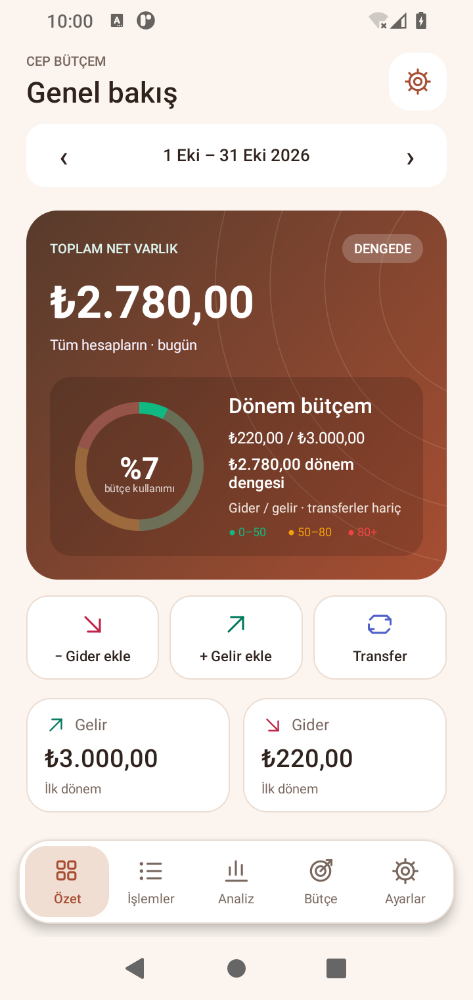

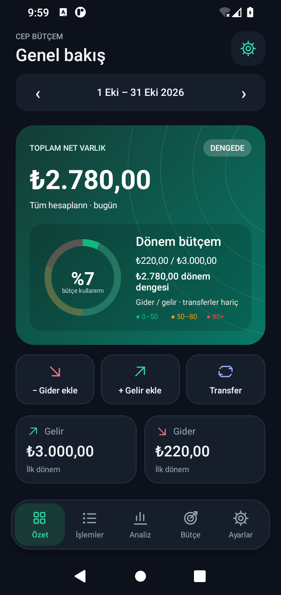

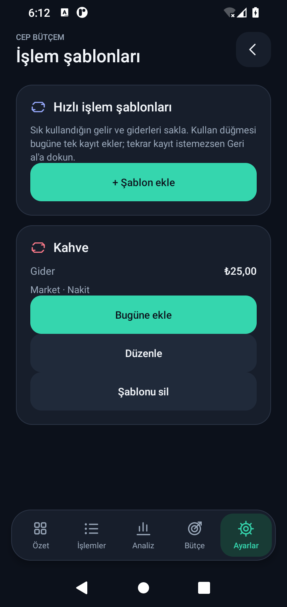

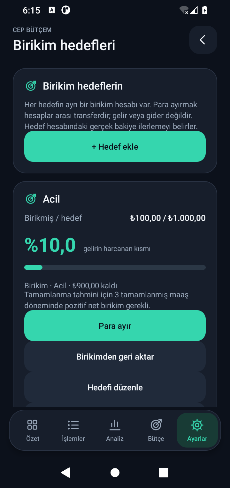

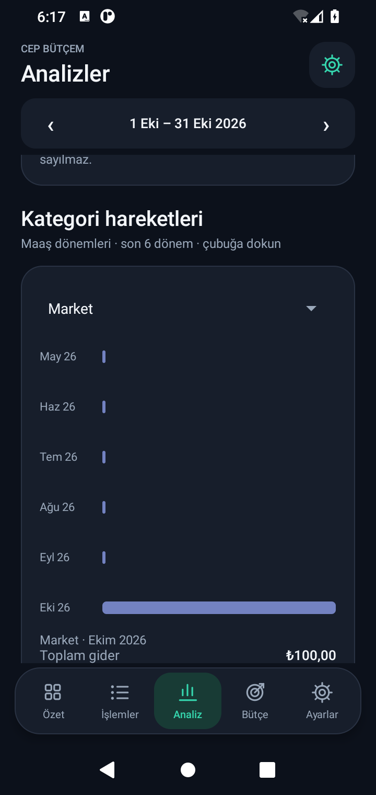

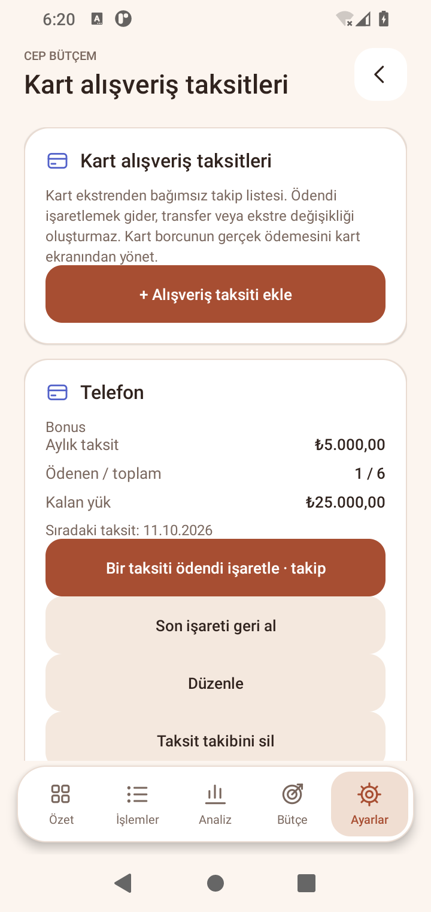

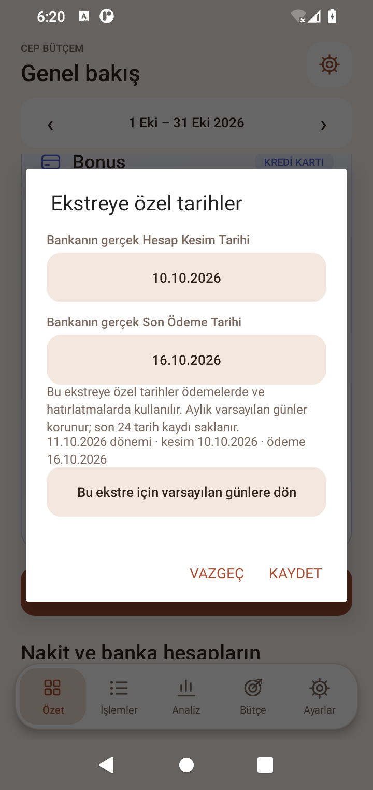

Ekranlar emülatördeki örnek kayıtlardan alınmıştır; kart senaryosunun test verileri kontrollerden sonra kaldırılmıştır.

Referanslar: [güncel halka, 7c3139c App.jsx](https://github.com/Semih-borsa/codex/blob/7c3139c943eda13864521660112e40cd9d241dbd/downloads/App.jsx#L837) · [yarım daire ibre, ilk incelenen 4e23af1 App.jsx](https://github.com/Semih-borsa/codex/blob/4e23af14b5fd2c2881c59fd7d8868eaf0855b1d8/downloads/App.jsx#L815).

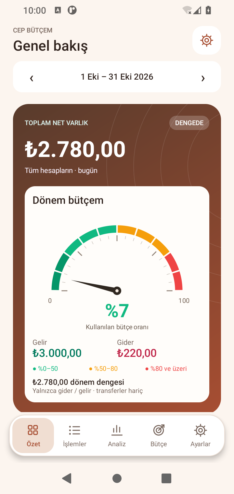

## Önceki sürümler

# v1.7 · Bütçe halkası ve sıcak finans tasarımı

## v1.7 · Sıcak palet, bütçe halkası ve ayrı kartlar

- Açık tema: vurgu **#A74E32**, zemin **#FCF5EF**. Ana kart harcama riskine göre sıcak ton değiştirir; gelir/gider renkleri anlamlarını korur.
- Dönem bütçesi, sıfırdan güncel yüzdeye gelen yuvarlak göstergeyle sunulur. Gelir yoksa “—”; %100 aşılırsa gerçek yüzde yazılır.
- Toplam kalan ekstre ve dönem içi + provizyon, büyük finans kartının içinde iki ayrı kutudur; ödenen ekstre küçük yazıyla görünür.
- Her kutu aynı kartların önceki maaş dönemindeki son banka kaydına göre artış/azalış gösterir. Geçmiş yoksa veya bir kartın verisi eksikse oran üretilmez. Sıfır borçtan artışta yüzde yerine açıklama kullanılır.
- Kart başına son 24 maaş döneminin banka özetleri saklanır. Maaş günü değişince eski aralıklarla oran karşılaştırılmaz. İlk kullanımda önceki dönem verisi son kayıttan alınabilir; uygulama bilinmeyen geçmişi tahmin etmez.
- Ayarlar → Krediler/Maaş/Ödeme takvimi → geri, Ayarlar’a döner. Bir alt ekran başka bölümden açılmışsa geldiğin yere dönersin.
- Banka/nakit hesapları ve kartlar ayrı listelenir. İşlem formunda kaynak listesi banka/nakit içerir; giderde **Ödeme yöntemi → Kredi kartı** ayrı kart seçimini açar. Transfer iki tür arasında yapılabilir.
- Kart takibi silinince geçmiş kayıtlar korunur ve hesap banka listesine karışmaz. Ayarlar’daki Kartların bölümünden takibi yeniden açabilir veya onayla kart hesabını ve bağlı kayıtları kalıcı silebilirsin.

JSON yedek biçimi v6; v1–v5 yedekleri okunur. v6 yedeğini v1.7 ve üzeriyle aç. Kart geçmişi işlem tutarı değildir; banka özeti güncellemek tek başına gelir/gider yaratmaz.

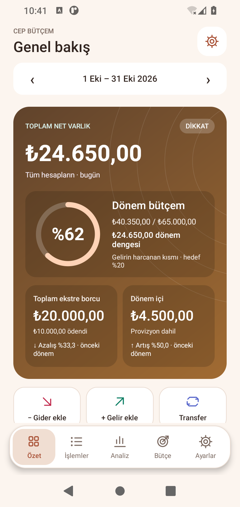

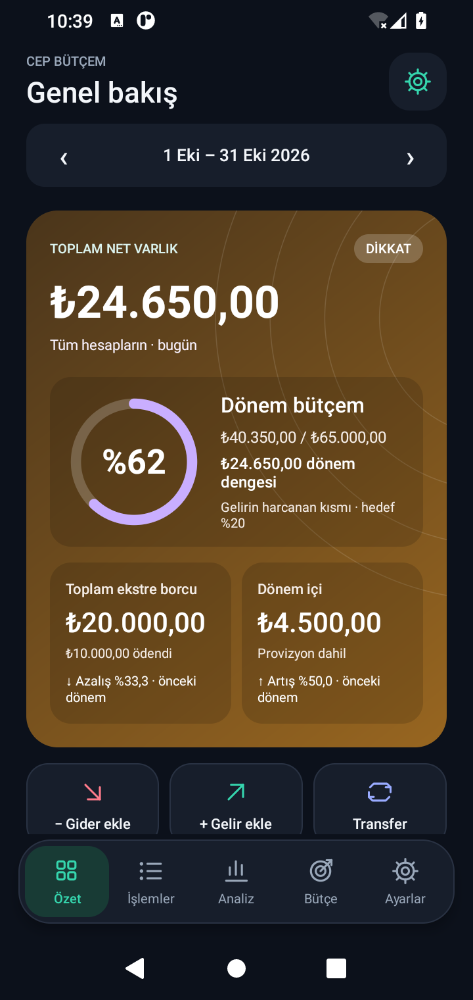

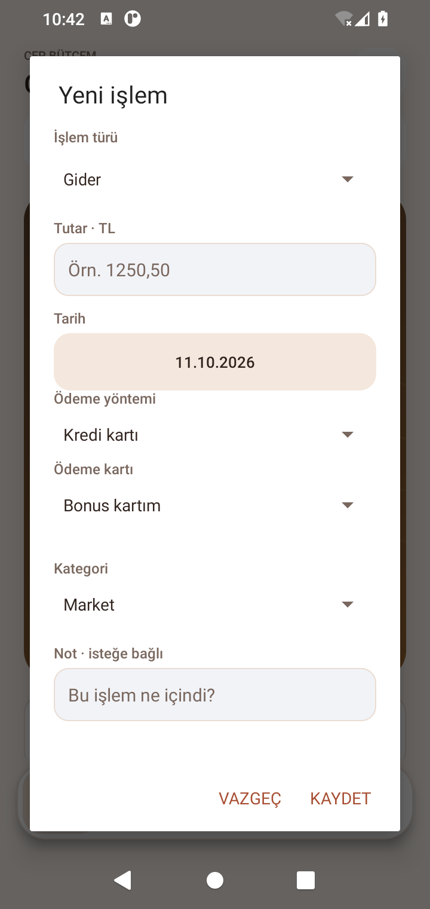

## Önceki sürüm

# v1.6 · Birleşik finans kartı ve ödeme özeti

Net varlık ve dönem bütçesi ortak bir yüzeyde birleştirildi. Risk rengi ve durum etiketi tüm kartı kapsar; yüzde, ilerleme çubuğu ve dönem dengesi beyaz kontrastla okunur. Hızlı işlemler bu kartın hemen altında yer alır.

Kart bölümünün başında iki toplam kutusu bulunur: kalan ekstre/ödenen tutar ve dönem içi/provizyon dahil. Güncel banka özeti olmayan kartlar sıfır varsayılmaz; toplam dışında tutuldukları belirtilir. Bireysel kartlarda Hesap Kesim Tarihi etiketi kullanılır.

Yaklaşan ödemeler bugünden 7 gün sonraya kadar bekleyen fatura, kredi ve kart ekstrelerini sıralar. Her satır gün sayısını, tutarı ve Ödendi olarak işaretle eylemini içerir. Liste 20 kayıt halinde sayfalanır; ödenmiş, gecikmiş ve daha uzak ödemeler ödeme merkezinde kalır.

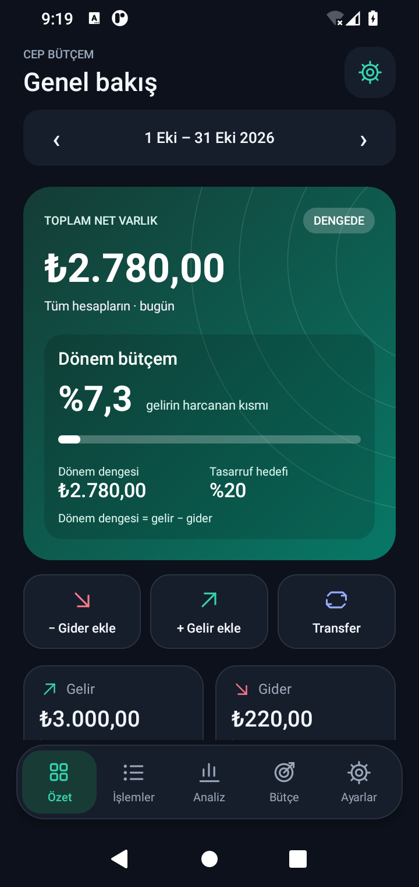

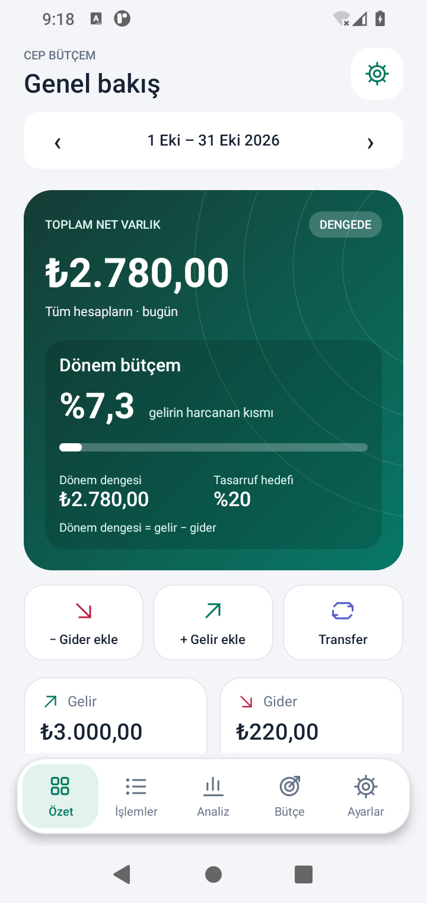

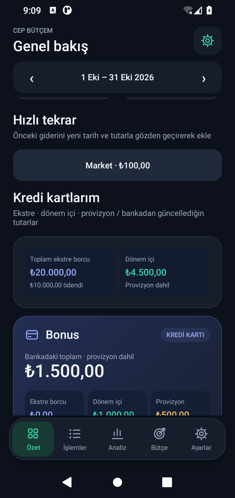

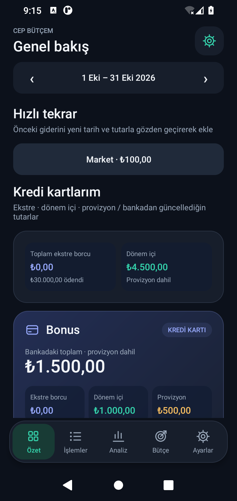

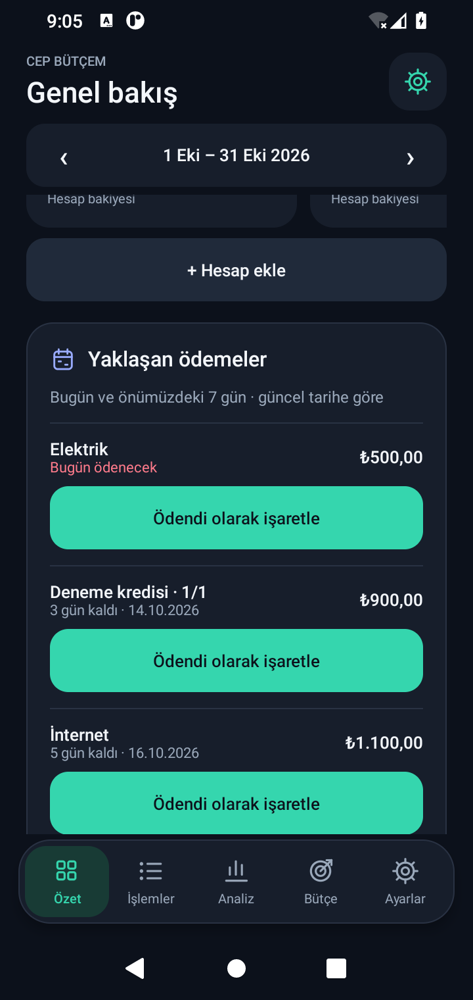

## Önceki sürüm tasarımları

# v1.5 · Modern mobil tasarım

Özet ekranında önce bugünkü net varlık, sonra seçili maaş döneminin gelir/gideri ve harcama oranı görünür. Net varlığın altındaki yaylar dekoratif marka öğesidir; finansal grafik olarak sunulmaz. Kaydırılan içerikten ayrı, sabit bir alt gezinme çubuğu ana bölümleri erişilebilir tutar. Finans araçlarında ilgili üst bölüm de seçili görünür.

| Tasarım değeri | Açık tema | Koyu tema |
|---|---|---|
| Sayfa | `#F4F5F8` | `#0C111B` |
| Kart | `#FFFFFF` | `#171E2B` |
| Ana metin | `#172233` | `#F3F6FA` |
| İkincil metin | `#657286` | `#9AA8BA` |
| Kenarlık | `#E6E8EE` | `#293243` |
| Olumlu/gelir | `#00795D` | `#35D6AE` |
| Gider | `#BF2448` | `#FF7B8B` |
| Transfer | `#5261C9` | `#99ABFF` |

Kartlar 20 dp köşe, ana kart 24 dp köşe, tutarlı 12 dp aralık kullanır. Başlıklar 22 sp, ana bakiye 34 sp ve alan uygunsa otomatik küçültme, hızlı işlem etiketleri 11 sp'dir. Dönem okları en az 48 dp, hızlı işlem alanları en az 64 dp, alt sekmeler 54 dp dokunma alanı taşır. Formlar ve işlem satırları ortak yüzey ve yazı stilini kullanır.

Dönem bütçesi gösterge çubuğu ve net varlık kartı aynı risk eşiklerine bağlanır: %50 altı yeşil, %50–80 sarı, %80 ve üstü kırmızı. Metinsel durum etiketi renk bilgisini tamamlar. Gelir yoksa oran hesaplanmaz. Sayı gerçek yüzdeyi gösterir; ilerleme çubuğu %100'de dolar. Yeni kompakt gösterge Android yazı ölçeğini takip eder, genişliğe sığmayan oranı küçültür ve animasyonlar kapalıysa son değeri doğrudan gösterir. Açılış animasyonu bir saniyedir; ekran ayrılırken durdurulur.

Arka plan çiziminin gradyanı ve Path geometrisi ölçü değiştiğinde hazırlanır; çizim sırasında yeniden dizi/Path oluşturulmaz. Analizde uzun hesap açıklamaları aynı kartın içinde açılıp kapanır. Karşılaştırma verisi yoksa nötr metin kullanılır. Finans sorguları, sayfalama ve veri modeli aynı kalır.

## Emülatörden gerçek ekranlar

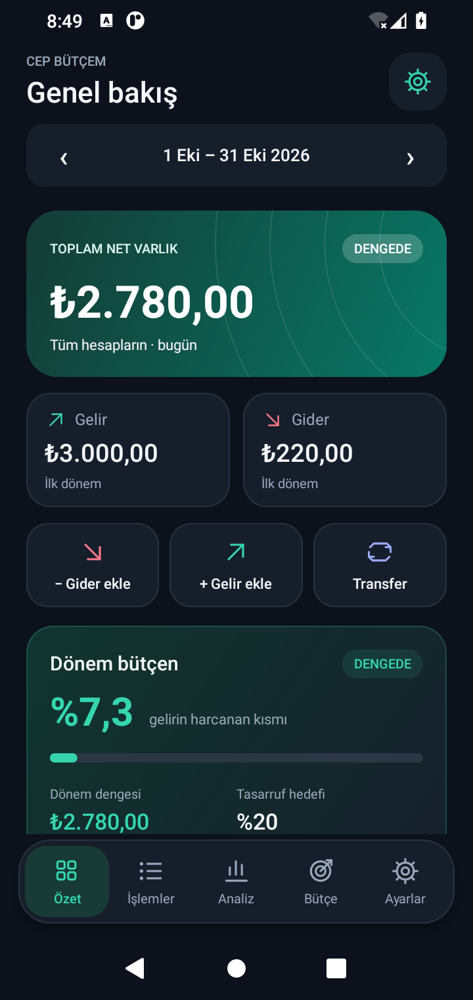

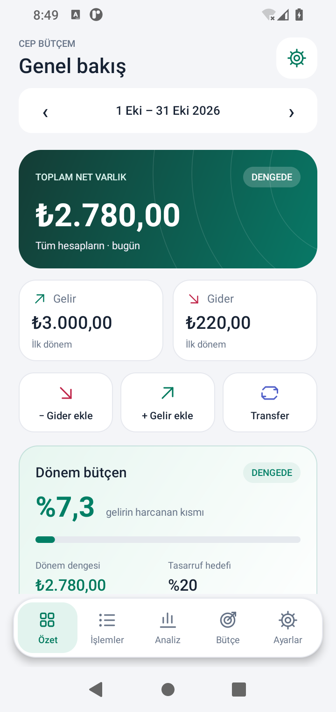

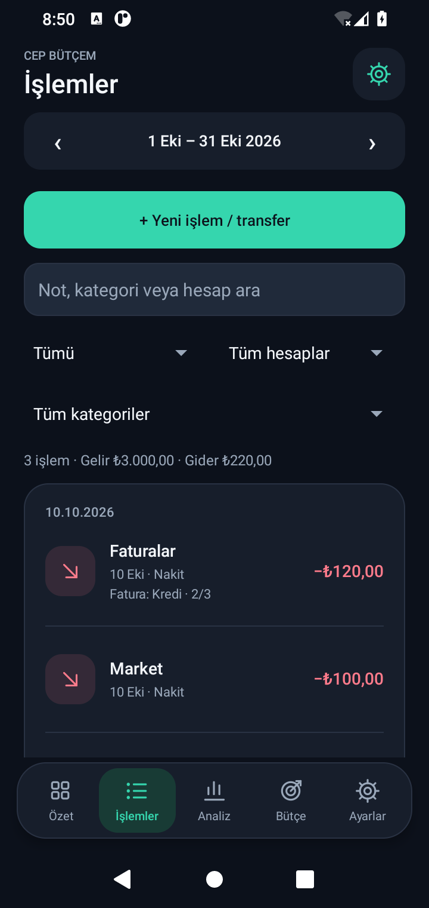

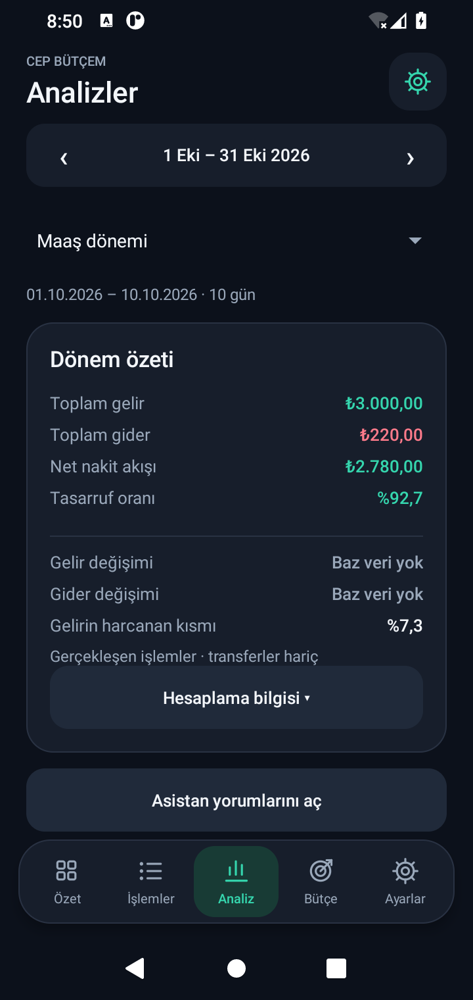

## Önceki sürümlerin tasarım kararları

# v1.2 tasarım uyarlaması

Kullanıcının paylaştığı `App.jsx`, React/Recharts ile hazırlanmış bir finans arayüzü. Yapısı, özet/işlemler/ödemeler/analiz bölümleri, yarım daire harcama göstergesi, tema değişkenleri, hızlı giriş, taksit/kredi ve maaş ekranları incelendi. Android uygulamasına seçilmiş tasarım fikirleri ve kullanım kolaylıkları yerel Java/Canvas bileşenleriyle uyarlandı. Dosyanın kendisi projeye eklenmedi; React, Recharts, web fontu, localStorage veya Capacitor gereksinimi oluşmadı.

## Uygulananlar

- Lacivert/teal/indigo palet; açık temada beyaz yüzeyler, ince kenarlar ve tutarlı boşluklar.
- Gradyan net varlık kartı; boyuta uyarlanan tutarlar ve önceki dönemle karşılaştırmalı gelir/gider kartları.
- Yarım daire harcama göstergesi ve tasarruf hedefi ilerlemesi. Gösterge yayı %100'de dolar; sayı %100 üzerindeki gerçek oranı göstermeye devam eder. Gelir yoksa yüzde üretilmez.
- Yatay hesap kartları ve hesap detayları; bugünkü bakiye ile maaş dönemi gelir/gideri ayrı etiketlenir.
- Yaklaşan faturaların tarih ve durumları; kart ve faturaları yöneten ayrı ödeme merkezi.
- Ana ekranda kısa asistan özeti; ayrıntılı yorumların ayrı ekranı. Analizde yorumlar açılıp daraltılabilir.
- Maaş döneminin tüm günlerini gösteren harcama haritası. Güne dokununca kayıtlar açılır; ekran okuyucular için tutarlı bir günlük liste de bulunur. Gelir, transfer ve henüz gerçekleşmemiş giderler harcama rengine dahil edilmez.
- Son giderlerden hızlı tekrar ve işlem satırına basılı tutarak tekrar ekleme. Önceki kayıt korunur, yeni işlem formu açılır; Kaydet'e basılana kadar gider oluşmaz. Fatura ödemeleri ödeme merkezinden yönetilir.
- Unicode sembolleri yerine yerel çizgi ikonları; dokunma geri bildirimi, yuvarlatılmış alanlar ve okunabilir başlıklar.

## Korunan hesap kuralları

Örnek dosyadaki `maasDonemiBul` gün değerini 28 ile sınırlar; bizde kullanıcı 1–31 seçebilir, kısa ayda son gün kullanılır ve sonraki ay tekrar tercih edilen güne dönülür. `donemHarcamaOrani` yüzdeyi 100 ile sınırlar ve birikimi kullanım toplamına ekler; bizde harcanan gelir oranı yalnızca gider/gelirdir, %100'ü aşabilir ve tasarruf ayrı gösterilir. Kart alışverişi gider, kart ödemesi transfer olmaya devam eder. Net varlık, harcanabilir banka bakiyesi veya kredi notu olarak etiketlenmez.

Taksit/kredi ve maaş zammı ekranları bu sürüme taşınmadı. Bunlar yalnızca görsel bileşen eklemekten daha fazla veri modeli ve muhasebe kararı gerektirir. Mevcut aylık faturalar ve düzenli işlemler korunur. Yeni görünüm kalıcı veritabanı şemasını değiştirmez; v1.1 kayıt ve JSON v2 yedekleri uyumludur.

## Erişilebilirlik ve uygulama yapısı

İkonlar dekoratif çizimlerdir; tıklanabilir alanlar adlandırılır. Alt gezinme ve ana eylemler en az 48 dp dokunma alanı kullanır. Harcama göstergesinin sayı ve metin karşılığı, haritanın günlük listesi, grafiklerin tutar listesi vardır. Tutar kartları metni mevcut genişliğe uyarlar. Açık/koyu tema tercihi korunur. Çizimlerde yollar ve yay geometrisi tekrar kullanılır; çizim sırasında yeni dizi/Path oluşturulmaz.

`Design.java` yerel ikon, gösterge ve harita; `MainActivity.java` ekranlar; `Finance.java` günlük gider toplama ve bağımsız tekrar taslağı oluşturma işlemlerini içerir. İnternet izni veya yeni çalışma zamanı bağımlılığı eklenmedi.

## v1.3 devamı

Kart, dönem bütçesi ve gösterge ortak `Finance.spendingBand` eşiklerini kullanır: %50 altı yeşil, %50–80 sarı, %80+ kırmızı; gelir yoksa nötr. Gauge açılışta bir saniye animasyon yapar; Android animasyonları kapalıysa doğrudan final değeri gösterir ve ayrılırken animator iptal edilir. Üst özet daha kompakt hale getirildi.

Her kredi kartı özette ayrı yüzey, üç tutar kutusu ve son güncelleme tarihiyle gösterilir. Kullanıcı bankadaki tutarları elle girer. Birbirini içermeyen kalan ekstre/dönem içi/provizyon toplamı yalnızca banka referansıdır; SQLite gelir/gideri veya kayıtlı net bakiyeyi değiştirmez. Yeni kart hesabı ile metadata aynı transaction'da oluşur. Kart takibini silme ve finansal hesabı/bağlı kayıtlarını silme farklı akışlardır; kapsam onay ekranında görünür. Yedek JSON v3, eski v1/v2 okuma ve doğrulama korunur.

Web için çalışan referans ve uzun vadeli mimari: [Altı bölümlük rehber](ARCHITECTURE.md). React refactoring'i yerel Android kaynaklarıyla veya bankayla otomatik senkronizasyon olarak sunulmaz.

## v1.4 devamı

Mint cüzdan + altın coin marka simgesi Android adaptive foreground/background olarak ayrıldı; tema simgesi için tek renk vektör eklendi. Finans araçları Ayarlar'da tek kartta: krediler, maaş hesaplayıcı, konuya özel yardım. Kredi ödeme eylemi tek açık karar sorar: **Bakiyeden düşülsün mü?** Evet gider, Hayır yalnızca takip. Kredi kartında takip edilen ödeme sayısı ayrıca açıklanır.

Harcama takvimi drilldown'ı modal yerine aynı kart altında gösterilir: seçili tarih → gelir/gider/gün dengesi → varsayılan kapalı detay listesi. Açılır gün seçici Canvas haritasının erişilebilir alternatifidir. İşlem ve gün detayları 50, ödeme kartları 20 kayıtla sınırlıdır. Arka plan sorguları ve gecikmeli arama ekranda gezinmeyi kilitlemez.

Bildirim kartı izin durumunu açık gösterir; aç/kapat, gün öncesi ve saat seçimi ile deneme bildirimi içerir. Kilit ekranında ödeme tutarı yerine genel hatırlatma görünür. Maaş Hesapla/Zam Oranları sekmeleri App.jsx akışını izler; girişler tahmini anında günceller. Kaydet yalnızca maaş ayarlarını ve oranları saklar, finansal kayıt oluşturmaz.

## v1.8.3 · Kaydırma ve liste sürekliliği

Ana ScrollView konumu aynı sayfanın ilk çiziminden önce geri yüklenir; başka sayfaya geçiş sıfırdan başlar. İşlem sorgusunun seçili sayfası kaydedilir; son 50 satır geçici önizleme olarak tutulur. Filtre veya maaş dönemi değişirse liste sayfası sıfırlanır. Ekran yeniden oluşturulurken asenkron sorgu sonuçlanana kadar kaydırılabilir alan korunur. Asistan ayrıntıları düğmenin altına eklenir. Dialogların kendi kaydırması bu korumadan bağımsızdır.
