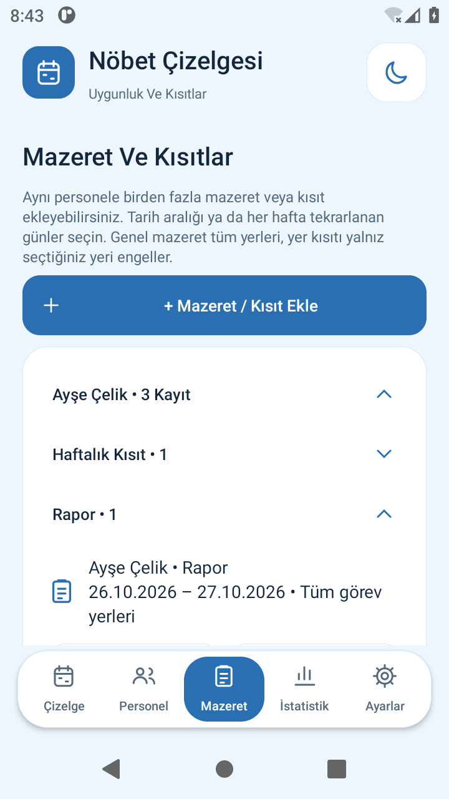
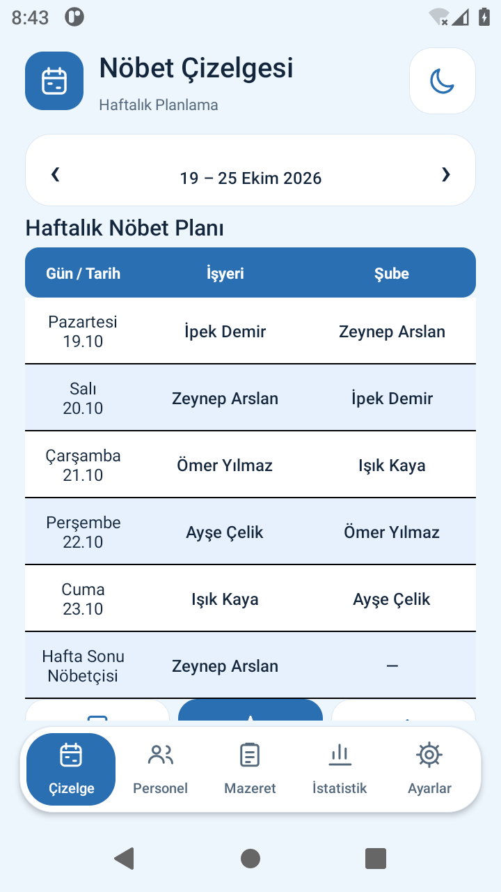
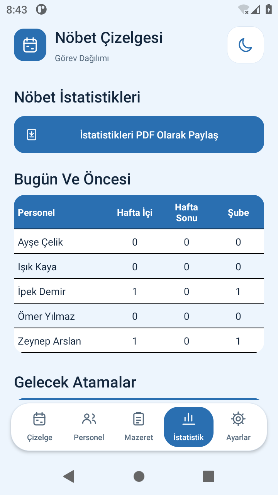

# 2.3 — Dengeli Dağıtım Ve Mazeret Grupları

Dört uygun personel beş açık güne atanırken, haftalık sınır izin veriyorsa dağılım **1–1–1–2** olur. Geçmiş toplamlar bu haftanın dengesini bozamaz. Eski kod, geçmişte az görevi olan personele aynı hafta tekrar görev vererek bazı personelleri dışarıda bırakabiliyordu.

Dağıtım her görev yerinde mevcut diğer atamaların, izinlerin ve dinlenmenin izin verdiği günleri değerlendirir. Önce doldurulabilecek en fazla gün, sonra görev alan farklı personel sayısı, ardından haftalık tekrarların dengesi hedeflenir. Alternatifi az personel/günler önce değerlendirilir; gerekirse önceki geçici seçimler yeniden yerleştirilir. Bir yerde esnek olan kişinin başka yerdeki az sayıdaki uygun günü gereksiz tüketilmez. Geçmiş nöbetler eşit haftalık seçenekler arasında tercih sağlar.

Bu hafta bir yere hiç gelemeyen personel zorla atanmaz. **Haftalık sınır 1 ise dört personelle beş gün doldurulamaz:** dört kişi birer kez atanır, kalan gün ve nedeni uyarıda görünür. Beşinci günü otomatik doldurmak için ilgili yerin haftalık sınırı en az 2 veya sınırsız olmalıdır. Manuel istisnalar ayrı teyit yolunu korur. İzin, rapor, haftalık kısıt, aynı gün iki yerde olmama ve hafta sonu görevlisinin Perşembe/Cuma dinlenmesi otomatik dağıtımda korunur.

Hafta sonu aynı kişi ve sıra/bekleyen mazeret hakkı kuralları değişmez. Hafta sonunun iki gerçek kaydı, işyeri hafta içi adalet sayımına karıştırılmaz. Daha önce onaylanan listeler kendiliğinden değişmez; ilgili haftada **Otomatik Dağıtım Öner** ile yeni öneriyi inceleyip kaydedin.

## Mazeret Ekranı

Personeller Türkçe alfabetik sırayla listelenir. Başlangıçta başlıklar kapalıdır. Personelin sağındaki oka basınca mazeret türleri; türün okuna basınca ilgili kayıtlar açılır. Senelik İzin, Rapor, Haftalık Kısıt ve diğer kayıt türleri ayrı gruplardır. Her grubun kayıt sayısı görünür. Yeni mazerette personel seçimi de alfabetiktir; kaydı düzenlerken mevcut kişi korunur. Açık başlıklar ekran yenilendiğinde ve tema değiştiğinde korunur.

## Tablo Ve Tema

Sağ üst tema denetimi ortalanmış bir simge düğmesidir; açık görünümde ay, koyu görünümde güneş gösterir. Sistem/Açık/Koyu seçim penceresini açar. Haftalık çizelge, normal ve resmî tatil istatistiklerinde satırlar siyah çizgilerle ayrılır. Aynı ayraçlar üç PDF çıktısında da vardır; PDF'lere açıklama veya imza alanı eklenmez.

Bu sürümde e-postasız kullanıcı hesabı veya yeni sunucu kurulumu eklenmedi. Yerel kullanım için Supabase gerekmez.
