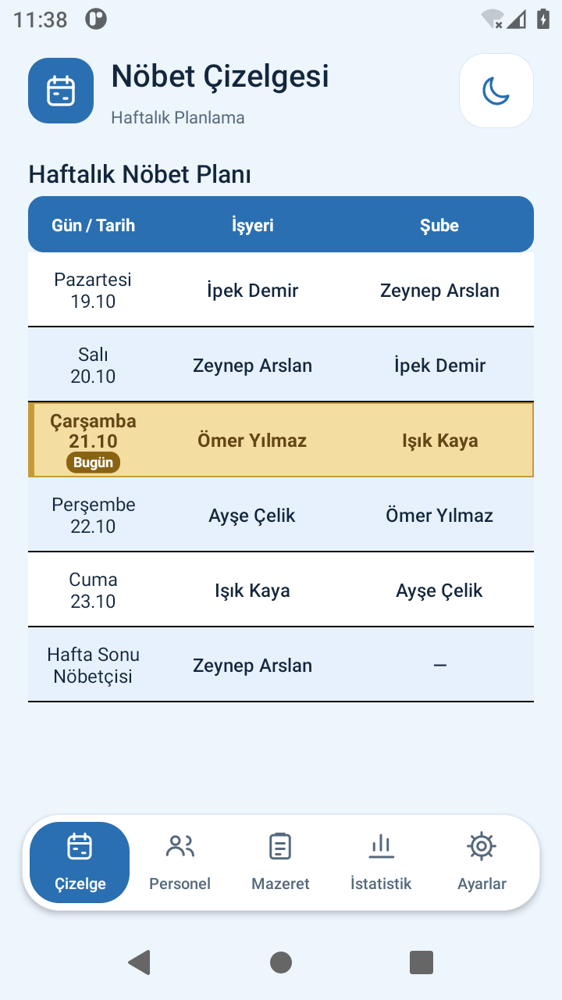
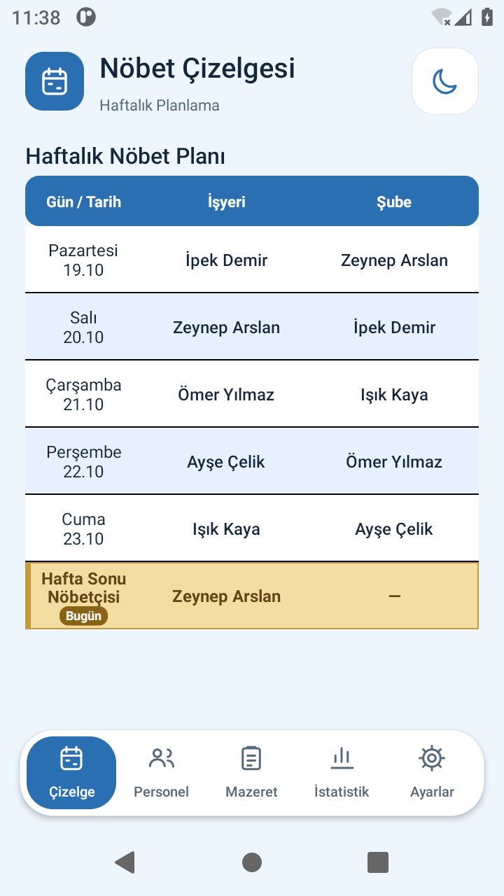
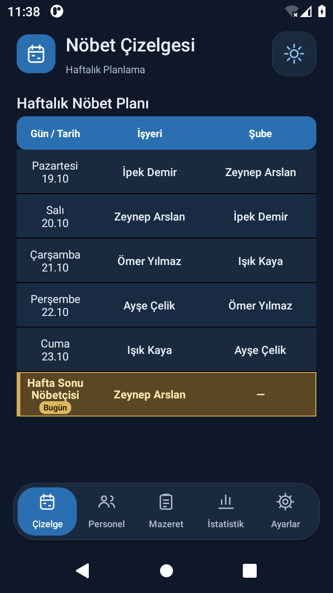

# 2.4 — Bugünün Satırı

Telefonun yerel tarihi çizelgenin haftası içindeyse ilgili satır bal sarısı zemin, altın sarısı kenarlık/sol şerit ve **Bugün** etiketiyle vurgulanır. Personel yazıları koyu kahverengi ve kalındır. Koyu temada koyu bal/amber zemin ile açık renk yazı kullanılır.

Pazartesi–cuma ilgili gün; **cumartesi ve pazar aynı Hafta Sonu Nöbetçisi satırı** vurgulanır. Başka haftada vurgu yoktur. Birden fazla görev yeri tablo grubunda aynı gün her grupta işaretlenir. Atama hücrelerine dokunarak düzenleme sürer.

Uygulama ön plana geldiğinde gün kontrol edilir. Açık kalırsa telefonun yerel saat dilimindeki bir sonraki gece yarısında yeniden kontrol planlanır; gün değişince sayfanın kaydırma konumu korunarak yenilenir. Cihaz tarihi/saat dilimi doğru ayarlanmalıdır.

Bu değişiklik yalnız çizelge ekranındaki gün vurgusudur; kayıtlı atamaları, dağıtım motorunu, istatistikleri veya PDF içeriğini değiştirmez.

Aşağıdaki Android emülatörü görüntüleri sentetik personellerle, testin sabitlediği hafta içi ve hafta sonu tarihlerinde alınmıştır:

