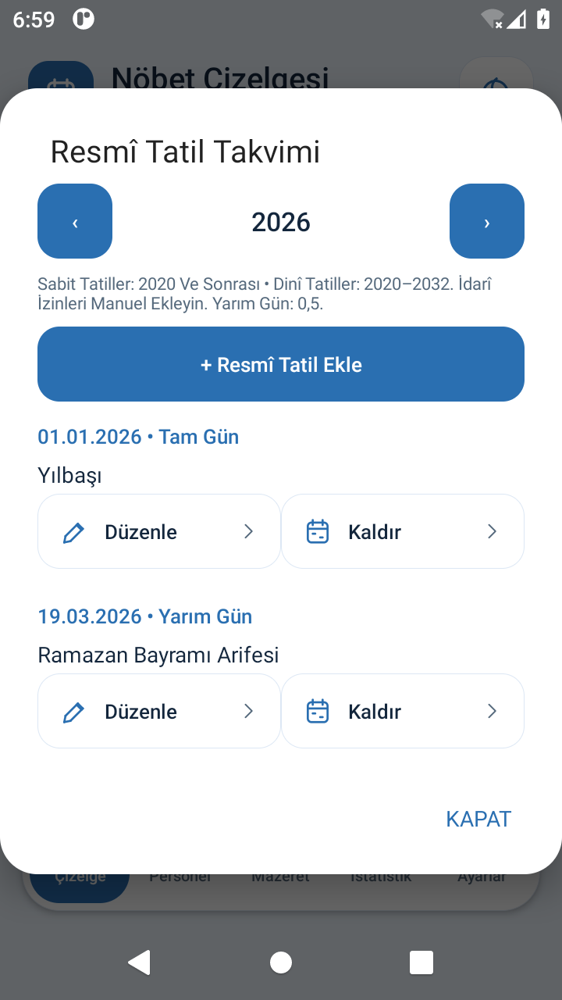
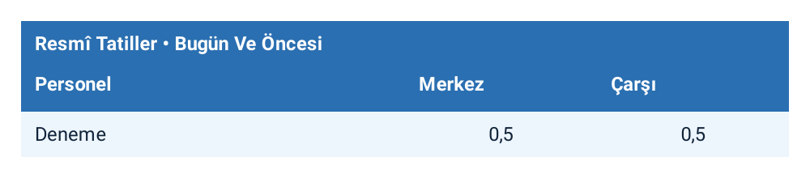

# Resmî Tatiller — 2.6

**Güncel sayım:** Yalnız çizelgedeki resmî tatil tarihine dokunup Tam Gün Çalışanlar penceresinde işaretlenen kişi/yerler 1 tam gün sayılır. Eski otomatik yarım gün sayımı geçmiş 2.1 davranışıdır; takvimin yarım gün bilgisi korunur ama tam gün çalışma kendiliğinden varsayılmaz. İptal kayıt yazmaz; Kaydet seçimi aynen değiştirir. Onaylar planlanan nöbetlerden ayrı saklanır. PDF de aynı sayım kaynağını kullanır.

## Önceki takvim açıklaması (2.1)

**Ayarlar → Resmî Tatil Takvimi** ile yılı değiştirin. **Resmî Tatil Ekle** yeni tarih/ad/süre kaydeder. **Düzenle** otomatik veya manuel kaydın tarihini, adını ve tam/yarım gün süresini değiştirir. Kaydetmeden önce teyit istenir.

- Tam gün **1**, yarım gün **0,5**. Arife günleri ve 28 Ekim 13.00 sonrası yarım gündür. Uygulama saat bazlı nöbet tutmadığından, o tarihteki görev yarım gün olarak sayılır.
- Aynı tarihte birden fazla tatil varsa aynı görev bir kez, en yüksek süreyle sayılır. Tam + yarım aynı gün toplamı 1'dir; 1,5 değildir.
- Aynı gün iki görev yerinde onaylı nöbet varsa her yer kendi sütununda sayılır.
- Normal istatistikler değişmez. Örneğin hafta içi bir tam tatilde şubede nöbet: normal Şube +1, ayrı Resmî Tatiller tablosunda aynı Şube +1. Yarım tatilde ise ayrı tabloda +0,5.
- Tatili veya kayıtlı nöbeti değiştirmek/silmek ayrı sayımları yeniden hesaplar. Ayrı birikmiş sayaç tutulmaz. Onaylanmamış taslaklar sayılmaz.
- Bugün Ve Öncesi ile Gelecek Atamalar ayrıdır. Pasif personel ve gizli/silinmiş şubelerdeki geçmiş görevler korunur. Yer adı değiştirilirse yeni ad kullanılır.
- İstatistik ekranındaki **Resmî Tatilleri PDF Olarak Paylaş** yalnız ayrı tatil tablolarını üretir. Normal istatistik PDF'si kendi düğmesinden paylaşılır.
- Tatil takvimi planlamadaki görev günlerini, mazeretleri ve hafta sonu sırasını değiştirmez. Nöbet kayıtları aynı kalır; gün kartlarında tatil adı görünür.

Otomatik kaydı **Kaldır** devre dışı bırakır; **Etkinleştir** geri açar. Düzeltilmiş/devre dışı otomatik kayıtta **Otomatik Kaydı Geri Yükle**, ilk tarih/ad/süreyi geri getirir. Manuel kaydı kaldırmak onu siler. Tarihi başka yıla taşınan otomatik kayıt eski tarihte tekrar üretilmez.

## Takvim kapsamı ve kaynak

Sabit tarihler **2020 ve sonrası** için: 1 Ocak, 23 Nisan, 1 Mayıs, 19 Mayıs, 15 Temmuz, 30 Ağustos, 28 Ekim yarım gün, 29 Ekim. Dinî tarihler **2020–2032** içindir: Ramazan Bayramı 3 gün, Kurban Bayramı 4 gün ve önceki arife günleri. Kapsam ayarlarda gösterilir. Bu aralığın dışındaki dinî tatiller tahmin edilmez; manuel ekleyin. Kandiller otomatik resmî tatil değildir; idarî izinler veya kuruma özel ek tatiller manuel girilir.

Tarih verisi 19 Ekim 2026'da [Vacanza holidays Türkiye](https://github.com/vacanza/holidays/blob/dev/holidays/countries/turkey.py) ve [İslami takvim tablosundan](https://github.com/vacanza/holidays/blob/dev/holidays/calendars/islamic.py) alındı. Türkiye sınıfı 1936–2032 aralığını doğrulanmış olarak işaretler; burada yalnız 2020–2032 alt kümesi kullanılır. Bu projede Python kütüphanesi çalıştırılmaz; seçili Miladi ilk günler Java tablosuna gömülüdür. Türkiye için bu alt kümede ayrıca tarih düzeltmesi bulunmuyor.

Kaynağın referansları: [2429 Sayılı Kanun](https://www.mevzuat.gov.tr/MevzuatMetin/1.5.2429.pdf), [Diyanet Hicri/Miladi Takvim](https://vakithesaplama.diyanet.gov.tr/hicriden_miladiye.php). Doğrudan Diyanet erişimi bu derleme ortamının ağ geçidinde engellendi; doğrudan resmî siteden çekilmiş veri iddiası yoktur. Takvim çevrimdışıdır; internetten kendiliğinden güncellenmez. Gelecekteki mevzuat/karar değişiklikleri kullanıcı tarafından düzeltilebilir.

Veri kaynağının MIT lisansı: [THIRD-PARTY-HOLIDAYS.txt](THIRD-PARTY-HOLIDAYS.txt).

## Önizleme

