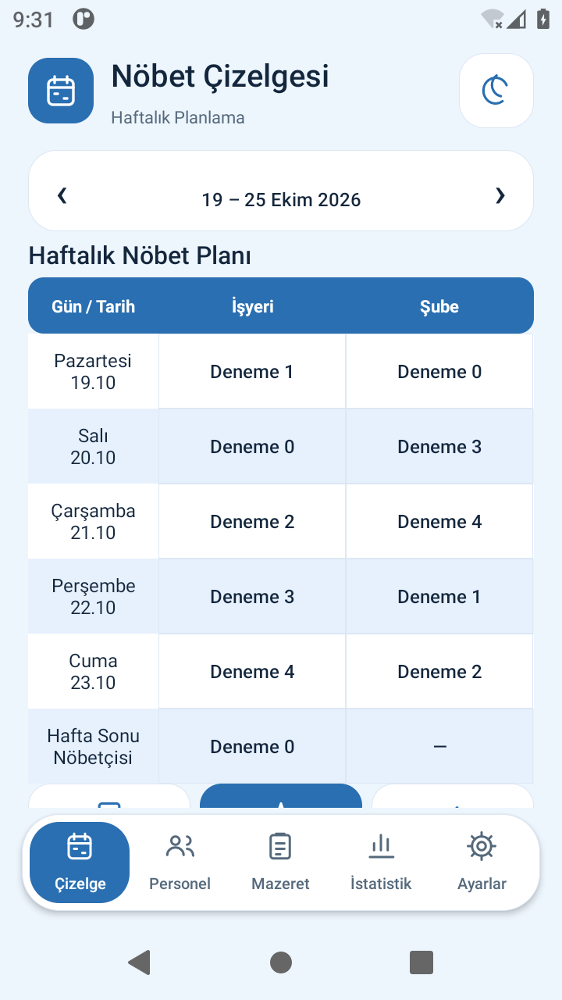
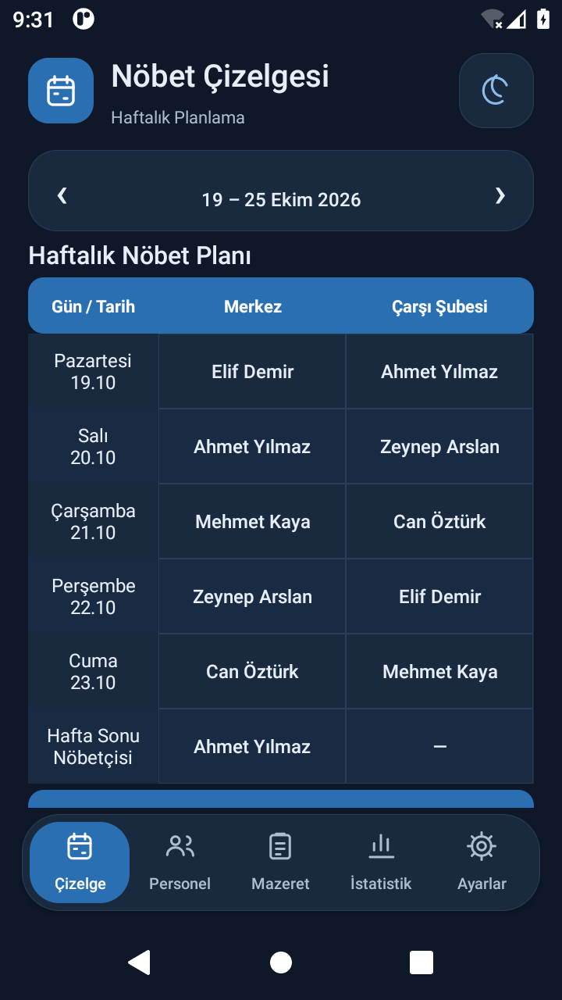
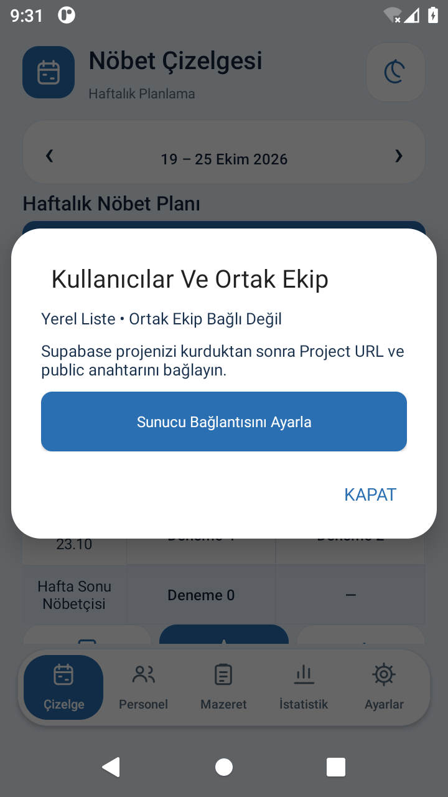

# Haftalık Tablo — 2.2

Çizelge ekranının üstündeki büyük özet kartı ve yedi ayrı gün kartı yerine PDF'ye benzer bir tablo gösterilir: Gün / Tarih, ana görev yeri ve şubeler. Pazartesi–Cuma satırlarını tek **Hafta Sonu Nöbetçisi** satırı izler. Telefonda yatay kaydırma kullanılmaz; çok şube varsa sütun grupları alt alta devam eder.

Hücreye dokunarak atama düzenleme korunur. Ana görev yerinde hafta sonu seçimi mevcut iki günlük atama akışını kullanır. Ek şubede hafta sonu hücresine dokununca Cumartesi/Pazar seçilebilir. İki günde farklı kişiler varsa tek satırın hücresinde **Cmt: … / Paz: …** bilgisi korunur; rastgele bir kişi seçilmez. Görev yeri bir gün kapalı, diğer gün açıksa açık günün görevlisi gösterilir. Boş alanlar **—** olur.

Görünüm birleştirilse de gerçek Cumartesi ve Pazar kayıtları ayrı kalır. İstatistik/mazeret/dinlenme/haftalık sınır kuralları ve tatil sayımları değişmez. Haftalık PDF de beş hafta içi satırı + bir hafta sonu satırı içerir; sayfa 700 × 324 puntodur. Gizli şubeler çizelge/PDF'den çıkar, istatistik ve kayıtları korunur.

İki görev yerli standart görünüm 360 × 640 dp emülatör ekranında haftanın tamamını gösterir. Uzun adlar, büyük erişilebilirlik yazısı ve çok şube gerektiğinde aşağı doğru alan kullanabilir; yazılar küçültülüp bilgi kaybedilmez. 280/320/360/600 dp genişliklerde hücre sınırları test edildi. Kalem/hücre seçimi sonrası görünen günün konumunu koruma da yeniden test edildi.

