# Nöbet Çizelgesi 2.0 — Tasarım

Repodaki Bütçe Takip / Cep Bütçem uygulamasının yuvarlatılmış kartları, özet alanı, çizgi simgeleri ve alt menüsü referans alındı. Finans uygulamasının sıcak renkleri yerine kurumsal mavi kullanıldı. Çizimler yerel Android Canvas ile üretilir; harici görsel, yazı tipi veya internet gerekmez.

- Haftanın tarih aralığı, kayıt durumu, hafta sonu nöbetçisi ve gerçek personel/görev/yer sayıları tek özet kartında.
- Şubeler, Otomatik Dağıt ve Manuel Liste işlemleri üç hızlı erişim kartında.
- Gün numarası ve hafta günü başlıklı nöbet kartları; görev satırlarında düzenleme simgesi.
- Personellerde baş harfli avatar, aktiflik ve hafta sonu sıra bilgisi.
- İki temaya uygun kartlar, diyaloglar ve simgeli alt menü. Sağ üst düğmeden tema seçimi.
- İstatistiklerin kompakt tablo düzeni ve sade PDF çıktıları korunur.

Nöbet motoru, kayıt biçimi, manuel istisna teyitleri ve paylaşım kuralları değişmedi. Önizlemelerdeki beş personel ve görev yerleri **sentetiktir**. Test yalnız geçici bellekte örnek durum oluşturur; gerçek kullanıcı listesine yazmaz.

## Açık ve koyu görünüm

| Açık | Koyu |
| --- | --- |
| 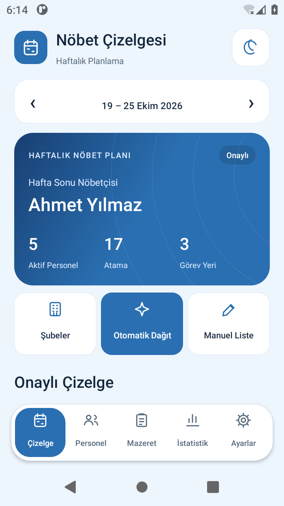 | 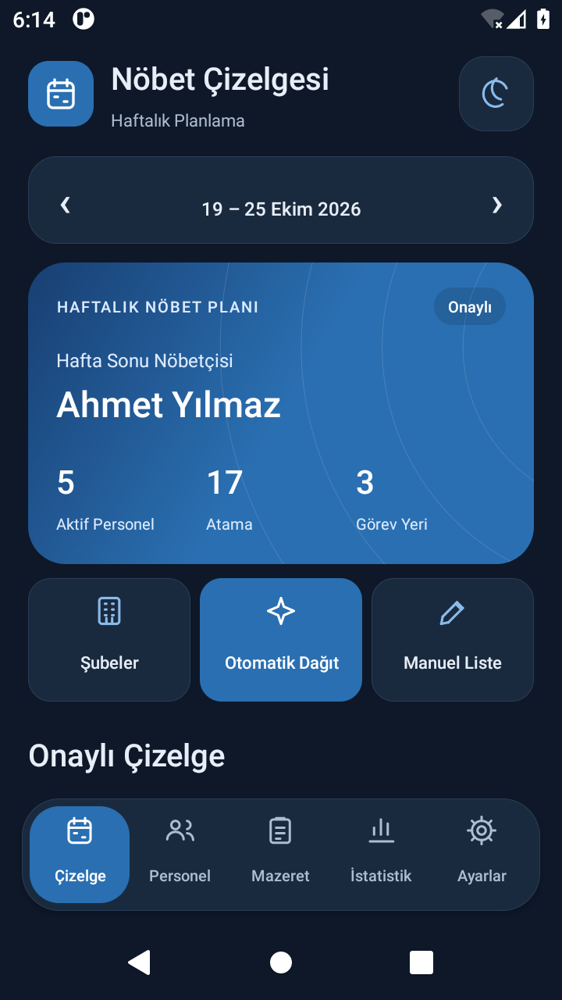 |
| 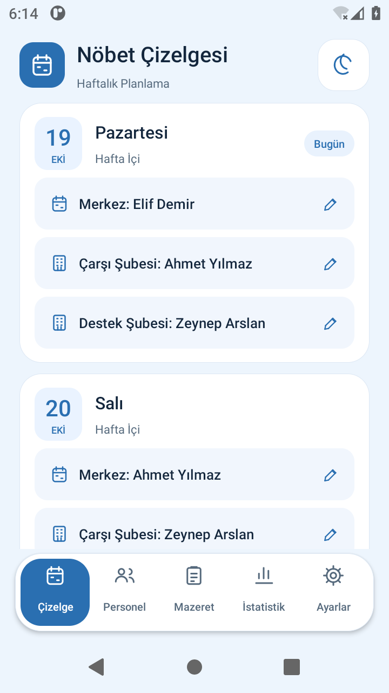 | 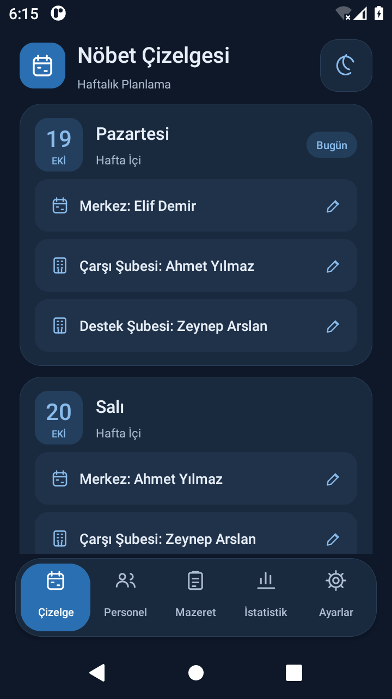 |
| 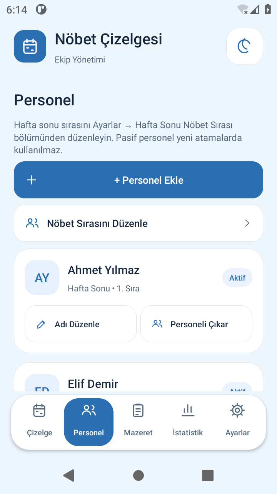 | 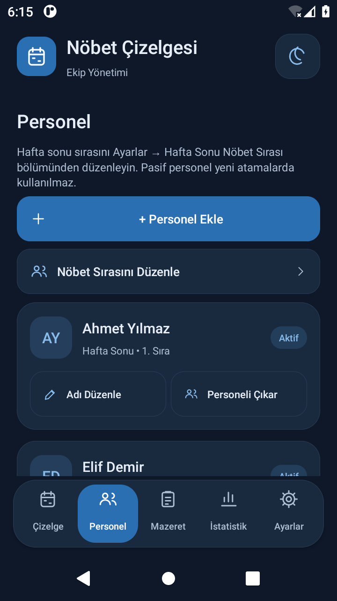 |
| 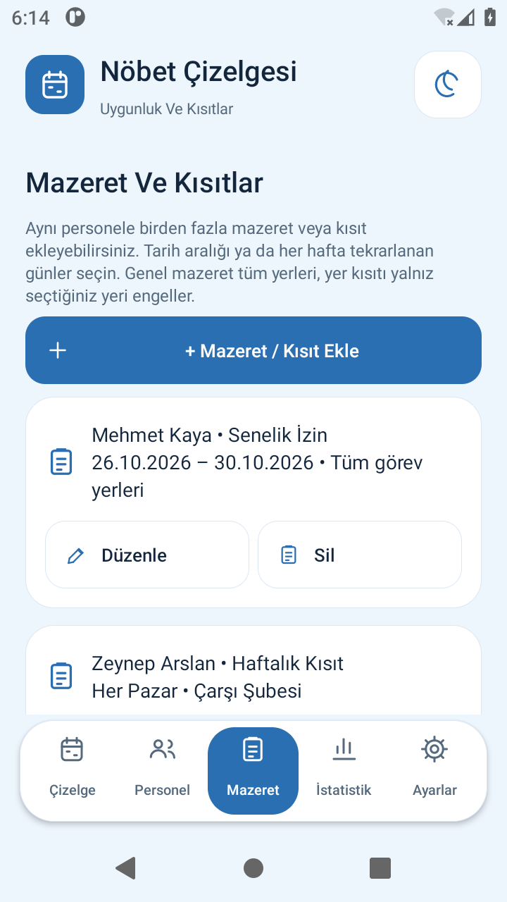 | 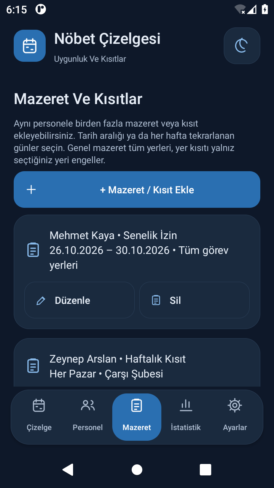 |
| 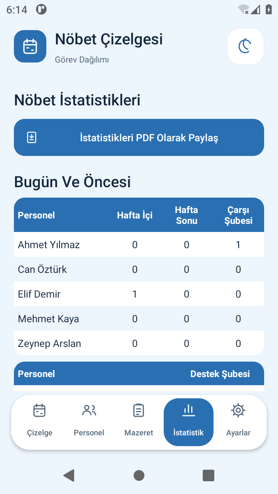 | 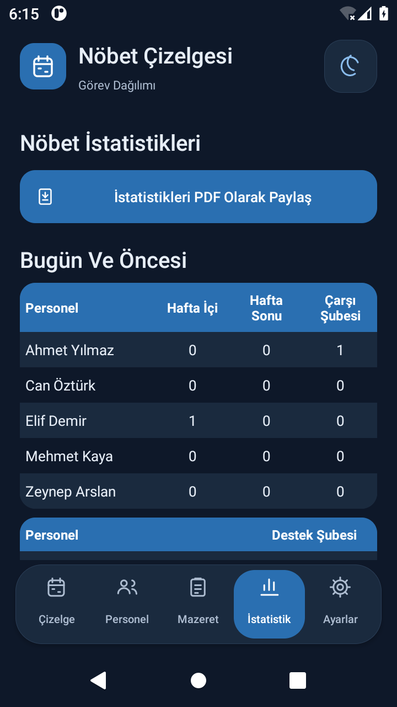 |
| 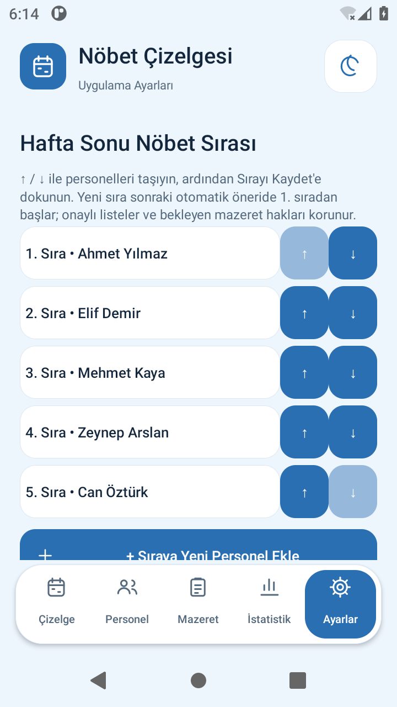 | 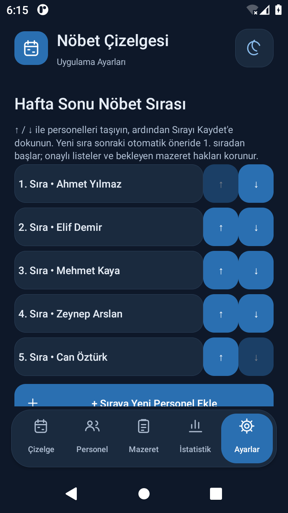 |

Android 11 emülatöründe alınmıştır. Doğrulama kapsamı ve sınırları [TESTLER.md](TESTLER.md) içindedir.
