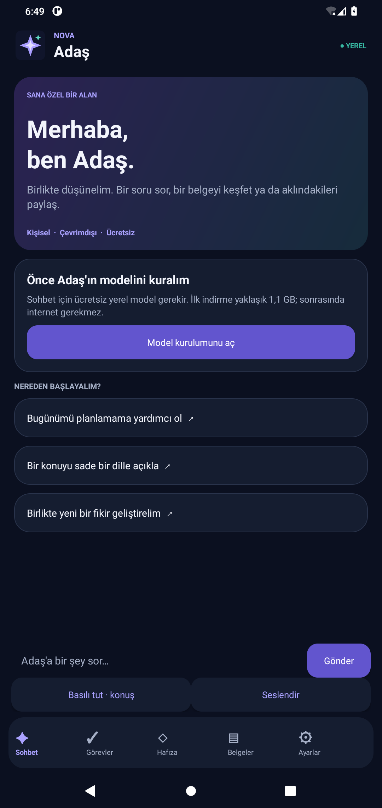

# NOVA AI 1.2 · Adaş

Yalnızca kişisel kullanım için, ücretli API veya abonelik gerektirmeyen Android uygulaması. Adaş, Qwen2.5-1.5B-Instruct Q4_K_M GGUF modelini **telefonun işlemcisinde** çalıştırır. Snapdragon 8+ Gen 1 / Xiaomi 12T Pro / 12 GB RAM hedeflenmiştir; gerçek cihazda hız ve kalite ölçümü henüz yapılmadı.

## v1.2 · Çok işlevli asistan

Uygulamayı **kaldırmadan APK'yı güncelle**. Aynı imza ve uygulama kimliği kullanılır. Sohbetler, hafıza, modeller ve görevler korunur; eski görevler kendiliğinden sesli olmaz. [NOVA-Adas-1.2.0.apk](https://github.com/Semih-borsa/codex/blob/main/downloads/NOVA-Adas-1.2.0.apk).

- **Konuşarak hatırlat:** “On beş dakika sonra su içmeyi sesli hatırlat”, “Yarın saat 15.00 faturayı hatırlat”. Tarih, saat, görev ve sesli okuma seçimi düzenlenebilir önizlemeye gelir. **Onayla ve kaydet** olmadan görev oluşturulmaz. Belirsiz/geçersiz/geçmiş zaman için tarih/saat seçmen istenir. Tarih seçimi cihazın saat dilimine göredir; aylık/yinelenen hatırlatma henüz yoktur.
- **Zamanı gelince sesli uyar:** Görevde sesli okumayı seç. Kurulu çevrimdışı Türkçe Android TTS sesi kullanılır; Qwen veya Whisper'ın açık olması gerekmez. Bildirimde **Sesli oku** ve okuma sırasında **Sesi durdur** bulunur. Ekran kilitliyken ses çevrede duyulabilir; yalnızca onaylı sesli görevler okunur. Sessiz mod, alarm sesi sıfır veya Rahatsız Etmeyin varken ses açılmaz. Bildirim korunur. Yeniden başlatma sonrası 10 dakikadan eski görevler kendiliğinden okunmaz.
- **İzinleri kontrol et:** Görevler ekranında bildirim izni ve Android 12+ kesin zamanlama izni durumu gösterilir. İzin ekranı ancak sen düğmeye dokununca açılır; ayarı sen yaparsın. Kesin izin yoksa yaklaşık alarm kullanılır. Xiaomi pil kısıtları, zorla durdurma, cihazın kapalı olması veya ses paketinin eksikliği teslimi/okumayı engelleyebilir; saniyesi saniyesine garanti verilmez. Telefonun Android sürümünde kilit ekranı ve pil kısıtlarıyla gerçek test gerekir.
- **Güvenli mesaj taslağı:** “+90 555 123 45 67 mesaj gönder: Yarın görüşelim”. WhatsApp varsayılandır. Numara elle girilir veya yalnızca seçtiğin kişinin numarası rehber seçicisinden alınır; tüm rehber izni yoktur. Alıcı/metin düzenlenir → **Önizle** → **Onayla ve aç** → WhatsApp/SMS içinde son **Gönder** işlemini sen yaparsın. Adaş göndermez, gönderildiğini iddia etmez. WhatsApp Business alternatifi desteklenir. İlgili uygulama yoksa hata gösterilir. Kişi adı tek başına gönderim adresi sayılmaz. Mesaj düzenleme onayı iptal edilirse veya ekran yeniden oluşturulursa mesaj açılmaz.
- **Ücretsiz kullanım sınırı:** Ücretli AI API'si veya abonelik yoktur. WhatsApp internetini kullanır. **SMS operatör tarifene göre ücretli olabilir**; bu nedenle varsayılan değildir ve ek ücret uyarısını onaylamadan taslak bile açılmaz. Sıfır ücret hedefi için SMS kullanma; Wi-Fi ile WhatsApp seç.
- **Kaynaklı araştırma:** “Güneş enerjisi araştır” veya sohbetin **Araştır** düğmesi. Sorgu internet üzerinden DuckDuckGo ve Türkçe Wikipedia'ya gönderilir; özel bilgi yazma. En fazla 5 web arama özeti ve 2 Wikipedia giriş metni, tıklanabilir kaynaklar ve sorgu zamanı gösterilir. Web sayfalarının tamamı okunmaz; sonuçlar otomatik doğrulanmış analiz sayılmaz. Kaynaklara erişilemezse bilgi uydurulmaz; **Kaynakları tarayıcıda ara** seçeneği bulunur. Genel sohbetten farklı olarak internet gerekir; yerel model kurulmadan da çalışır. Araştırma metni görev veya mesaj çalıştıramaz.

## v1.1 güncellemesi

Mevcut uygulamayı kaldırmadan güncelle; hafızalar, görevler ve seçili model dosyaları korunur. [Sürümü belli APK: NOVA-Adas-1.1.0.apk](https://github.com/Semih-borsa/codex/blob/main/downloads/NOVA-Adas-1.1.0.apk).

- Hava soruları artık yerel modelin tahminine bırakılmaz. Open-Meteo'dan anahtarsız ve kişisel kullanım için ücretsiz güncel tahmin alınır; internet gerekir. Şehir yoksa sorulur, yarın/bugün ayrımı şehir saat dilimindeki tarihe göre yapılır. Eksik veri veya bağlantı hatasında sıcaklık uydurulmaz. Son şehir Ayarlar'dan değiştirilebilir. GPS istenmez; sorguda şehir adı ve tahmin koordinatları dışında sohbet/hafıza paylaşılmaz.
- Open-Meteo / GeoNames kaynakları ve sorgu zamanı cevapta gösterilir. Veriler CC BY 4.0 atıf koşullarıyla kullanılır; https://open-meteo.com/ ve https://www.geonames.org/. Diğer canlı haber/fiyatlar için bağlantı yoksa bu belirtilir.
- Kelime tekrar cezası, yeni soruya aynı cevabı kopyalama kontrolü, yalnızca güncel soruyla tek yeniden deneme ve döngülü cevap reddi eklendi. Model bilgisi ilk çalıştırmadan sonra gerçek metadata ile gösterilir; uyumsuz model dosyası açıklanır. Bu önlemler 1.5B modelin genel anlama kapasitesini büyük bulut modeli düzeyine çıkarmaz.
- Sesli sohbet: bir kez başlat, konuş; yaklaşık 1,4 saniyelik duraklamada metin otomatik gönderilir. Cevap çevrimdışı Türkçe TTS ile okunur, okuma bitince yeniden dinlenir. Gönder'e basmak gerekmez. Bitir, uygulamadan çıkış, hata veya sessizlik zaman aşımı mikrofonu kapatır. Bu sürekli arka plan dinleme değildir. Whisper tiny modeli ve Türkçe TTS sesi gereklidir; desteklenen Android sistem tanıması alternatif olabilir.

## İndir ve kur

1. [NOVA-Adas.apk](https://github.com/Semih-borsa/codex/blob/main/downloads/NOVA-Adas.apk) dosya sayfasını aç. Depo özelse GitHub hesabınla giriş yap.
2. Dosya sayfasındaki **Download raw file** / aşağı ok düğmesine bas. Tarayıcının “Farklı kaydet” menüsü APK yerine HTML kaydedebilir.
3. APK'yı telefona kopyalayıp Dosyalar uygulamasından aç. Android isterse bu dosyayı açtığın uygulamaya yükleme izni ver. Bu ayarı NOVA kendisi değiştirmez.
4. Uygulamada **Ayarlar → Ücretsiz modeli indir** seç. Yaklaşık 1,1 GB indirme için Wi-Fi kullan; indirme boyunca uygulamayı açık tut. Model kurulduktan sonra sohbet uçak modunda çalışır.
5. İndirme çalışmazsa resmî [Qwen model deposundan](https://huggingface.co/Qwen/Qwen2.5-1.5B-Instruct-GGUF/tree/main) adı `q4_k_m.gguf` ile biten tek dosyayı indir; **İndirilmiş GGUF dosyasını seç** düğmesiyle içe al. `q4_0`, farklı model ailesi veya parçalı dosya seçme. Model dosyası APK'nın içinde değildir.
6. Sesli sohbet için **Ücretsiz ses modelini indir** ile yaklaşık 75 MB çok dilli Whisper tiny modelini kur. Alternatif: [Whisper deposundan](https://huggingface.co/ggerganov/whisper.cpp/tree/main) `ggml-tiny.bin` indirip uygulamada seç. `tiny.en` Türkçe değildir. Cihazda Android 12+ çevrimdışı tanıma servisi varsa bu model olmadan da kullanılabilir; bulut tanımaya geçilmez.
7. Sohbette **Sesli sohbet** düğmesine bir kez dokun. Konuşman durunca soru otomatik gönderilir; Adaş cevap verdikten sonra tekrar dinler. **Bitir** ile durdur. İlk kullanımda mikrofon izni ve çevrimdışı Türkçe ses paketi gerekir. Bir konuşma en fazla 30 saniye kaydedilir. Arka plana geçince konuşma modu kapanır.
8. Sesli cevap için telefonda **çevrimdışı Türkçe TTS sesi** kurulu olmalı. Seslendir düğmesini veya ayarlardan otomatik sesli cevabı kullan. Uygun ses yoksa uyarı gösterilir; ücretli servis kullanılmaz.

Kurulum, motorlar ve modeller ücretsizdir. İnternet/veri tarifesi, elektrik ve depolama kendi cihaz kaynaklarındır. Uygulama ücretsiz deneme kotasına veya ücretli sunucuya dayanmaz. Model/ses dosyaları ve belge işleme alanı için 4–6 GB boş alan önerilir.

## Bu APK'daki özellikler

- Açık/koyu tema, özgün yıldız simgesi, Türkçe sohbet ve durdurma.
- Sohbetin son 60 mesajını gösterme; geçmişi açık onayla silme.
- Açıkça eklenen, düzenlenebilen ve silinebilen kişisel hafıza. Modele kısa ve sınırlı hafıza bağlamı verilir; sınırsız geçmiş hatırlama vaat edilmez.
- Görev ekleme, tarih/saat seçme, tamamlama, yeniden açma ve onaylı silme. Yerel bildirim ve yeniden başlatma/saat diliminde yeniden planlama.
- PDF, DOCX, XLSX ve UTF-8 TXT metin çıkarma. 10 MB dosya sınırı; PDF en fazla ilk 30 sayfa, Excel en fazla 5 sayfa / 2.000 hücre; metin 100.000 karakterle sınırlı. Excel formülleri çalıştırılmaz, tarihler ham değer olabilir. Taranmış PDF için OCR bu sürümde yoktur.
- Soruyla ilgili sınırlı belge parçasını modele verme ve kaynak konumlarını metne ekleme. Küçük model kaynakları hatalı yorumlayabilir; cevap ile kaynakları kontrol et.
- Resmî depodan model indirmede SHA-256 ve boyut doğrulaması; GGUF/Whisper dosyası içe alma, indirmeyi durdurma ve açık onaylı dosya temizleme.

## Güvenlik sınırı

Adaş otomatik ödeme yapamaz, dışarıya mesaj gönderemez ve kritik sistem ayarlarını değiştiremez. Mesaj özelliği yalnızca yukarıdaki onaylı taslak akışıdır; gerçek gönderim kullanıcıdadır. Model çıktısı yalnızca metindir; görevleri/hafızayı kendiliğinden değiştirmez. Uygulama içindeki silme işlemleri seçilen veriyi gösteren ayrı onay gerektirir. Yarım model dosyaları kendiliğinden temizlenmez; **Model ve yarım dosyaları yönet** ekranından tek tek onayla silinir. Orijinal seçilen belgeler/model dosyaları silinmez.

Veriler uygulamanın özel alanında tutulur. Otomatik Android bulut yedeği ve cihaz aktarımı kapalıdır. Veritabanı ayrıca uygulama düzeyinde şifrelenmiş değildir; cihaz ekran kilidini kullan. Uygulamada hesap, sunucu veya API anahtarı yoktur. İnternet izni kullanıcı tarafından başlatılan model indirmeleri, hava sorusuna karşılık Open-Meteo/GeoNames sorguları ve açık araştırma komutuyla DuckDuckGo/Wikipedia sorguları içindir. Genel sohbet, belge, hafıza ve ses üçüncü taraf yapay zekâ API'lerine gönderilmez. Uygulamayı kaldırmak yerel verileri Android tarafından siler; ilk sürümde dışa aktarma/yedekleme ekranı bulunmaz.

Kesin zamanlama izni varsa kesin alarm, yoksa yaklaşık alarm kullanılır; Android Doze/Xiaomi pil kısıtları ve zorla durdurma yine bildirimleri geciktirebilir. Sesli okuma, süreli ön plan servisi ve en fazla 45 saniyelik işlemci uyanık tutma kilidi kullanır; sürekli dinleme veya sürekli arka plan servisi yoktur. Mikrofon/bildirim izinleri yalnızca ilgili kullanıcı işlemi sırasında istenir. Bildirim içeriği kilit ekranında özel olarak işaretlenir.

## Android Studio

[APK + Android Studio tam paket](https://github.com/Semih-borsa/codex/blob/main/downloads/NOVA-Adas-Android-Studio.zip) dosyasını **Download raw file** ile indir ve ZIP'i klasöre ayıkla. Android Studio → Open ile ZIP içindeki **NOVA-Adas** klasörünü aç; `settings.gradle`, `gradlew` ve `app` aynı klasördedir.

Gerekenler: JDK 17, Android SDK 35, NDK **27.2.12479018**, CMake **3.22.1**. SDK Manager → SDK Tools → Show Package Details üzerinden sürümleri kur. Gradle senkronizasyonundan sonra Build → Build APK(s). İlk derlemede ücretsiz Gradle/Maven bağımlılıkları indirilir. Kurulan Flutter olmadığı için ilk APK yerel **Java + JNI/C++** ile hazırlanmıştır. Windows EXE henüz üretilmedi.

Komut satırı: `./gradlew testDebugUnitTest lintDebug assembleDebug assembleDebugAndroidTest`. Android 8+ ARM64 telefonlar ve x86_64 emülatör için derlenir. NDK kurulumunu özel konumdan kullanmak gerekirse `NOVA_NDK_PATH` ortam değişkeni tanımlanabilir. Kişisel APK debug imzalıdır; mağaza yayınına hazırlanmış üretim sürümü değildir.

## Açık kaynak bileşenleri

- llama.cpp b6800, `0398752dd450dfabdd1b9e289f6364c2600f6ab5`, MIT. Kaynak ve lisans: `app/src/main/cpp/llama`.
- whisper.cpp v1.7.6, `a8d002cfd879315632a579e73f0148d06959de36`, MIT. Kaynak ve lisans: `app/src/main/cpp/whisper`. Birlikte derlenen GGML CPU arka ucu kullanılır.
- Qwen2.5-1.5B-Instruct, Apache-2.0; model ağırlıkları ayrı indirilir.
- Whisper tiny çok dilli, MIT; model ağırlıkları ayrı indirilir.
- jsoup 1.18.3, MIT; arama sonucu HTML çözümleme. Wikipedia giriş metinleri CC BY-SA, kaynak bağlantıları sonuçlarda gösterilir.
- PDFBox Android 2.0.27.0 / Apache PDFBox, Apache-2.0; şifreli PDF desteği kapsam dışıdır, Bouncy Castle bağımlılıkları bu kişisel sürümde alınmaz.

Doğrulama kapsamı ve sınırlar: [docs/VALIDATION.md](docs/VALIDATION.md).
